```{=html}
<style>
body { color: #212529; }
blockquote { color: #212529; font-size: inherit; font-style: normal; }
p, li { overflow-wrap: break-word; }
@media (max-width: 768px) {
  img { max-width: 100%; height: auto; }
  p, li { overflow-wrap: anywhere; }
}

/* =========================================================
   SHM 377 Lab-02 Part B: The Eight Step Process® Cover
   ========================================================= */

.cover-image img {
  width: 100%;
  height: 340px;
  object-fit: cover;
  object-position: center;
  border-radius: 5px;
}

.cover-image p {
  margin-bottom: 0;
}

.cover-caption {
  font-size: 0.85rem;
  color: #555;
  line-height: 1.45;
  margin-top: 0.5rem;
  margin-bottom: 1.75rem;
}

/* =========================================================
   Mobile
   ========================================================= */

@media (max-width: 768px) {
  .cover-image img {
    height: auto;
    object-fit: contain;
  }
}


/* =========================================================
   SHM 377 | Screen Readability
   ========================================================= */

main p {
  line-height: 1.7;
  margin-bottom: 1rem;
}

main ul,
main ol {
  margin-top: 0.75rem;
  margin-bottom: 1.5rem;
}

main li {
  line-height: 1.6;
  margin-bottom: 0.5rem;
}

main h2 {
  margin-top: 2rem;
  margin-bottom: 1rem;
}

main h3 {
  margin-top: 1.5rem;
  margin-bottom: 0.75rem;
}


/* =========================================================
   SHM 377 | Clickable Checklist Images
   ========================================================= */

.checklist-image img {
  cursor: zoom-in;
  transition: transform 0.2s ease;
}

.checklist-image img:hover {
  transform: scale(1.03);
}


/* =========================================================
   SHM 377 | Section Images
   ========================================================= */

.text-center img {
  display: block;
  max-width: 100%;
  height: auto;
  margin: 1.5rem auto;
  border-radius: 5px;
}

@media (max-width: 768px) {
  .text-center img {
    width: 100%;
  }
}


/* =========================================================
   SHM 377 | Illustrated Checklist
   ========================================================= */

.checklist-item {
  display: grid;
  grid-template-columns: 180px minmax(0, 1fr);
  gap: 1.25rem;
  align-items: start;
  margin: 1.75rem 0;
  padding-bottom: 1.25rem;
  border-bottom: 1px solid #e5e7eb;
}

.checklist-image img {
  display: block;
  width: 100%;
  height: auto;
  border-radius: 6px;
  margin: 0;
}

.checklist-image p {
  margin: 0;
}

.checklist-content {
  min-width: 0;
}

.checklist-content > p:first-child {
  margin-top: 0;
  margin-bottom: 0.5rem;
}

.checklist-content ul {
  margin-top: 0.5rem;
  margin-bottom: 0;
}

.checklist-content li {
  margin-bottom: 0.45rem;
}

@media (max-width: 768px) {
  .checklist-item {
    grid-template-columns: 1fr;
    gap: 0.75rem;
  }

  .checklist-image img {
    width: 100%;
    max-width: 280px;
  }
}


</style>
```


# The Eight Step Process®

**SHM 377: Hazardous Materials Management**

**Central Washington University**

**Professor Yoni Rodriguez**

*Hazardous Materials: Managing the Incident*

::: {.cover-image}
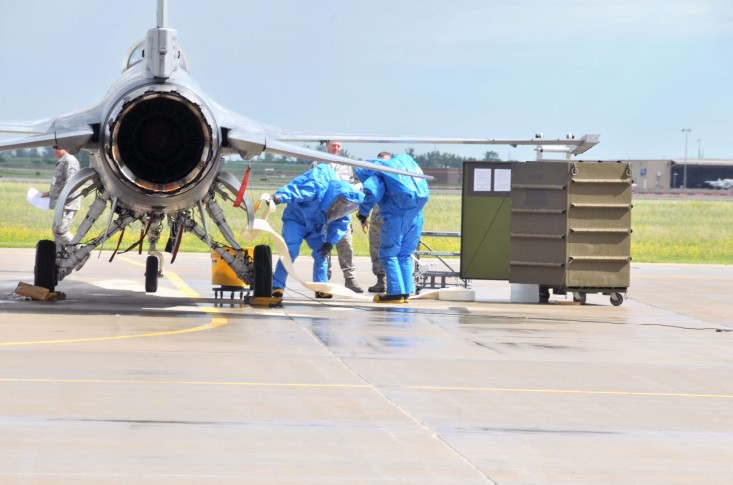{width="100%"}
:::

::: {.cover-caption}
**Figure 1.** Hazardous materials response training involving an F-16 aircraft. 

*Source: U.S. Air Force, 140th Wing, "Training for worst case scenario," July 12, 2008.*
:::


## The Eight Step Process®

The Eight Step Process® outlines the basic tactical functions that need to be evaluated and implemented at hazmat incidents. Also, the Eight Step Process® is widely used throughout the country by government and private sector hazmat response teams.

On-scene response operations must always be based on a structured and standardized system of protocols and procedures. Regardless of the nature of the incident and response, a standardized procedure will bring consistency to the incident. If the situation may involve hazmats or weapons of mass destruction (WMD), standardized tactical response procedures help minimize the risk of exposure to all responders.

Like all standard operating procedures (SOPs), the Eight Step Process® should be seen as a flexible guideline, not a rigid rule. Individual departments and agencies should decide what works best for them.

## Benefits of the Eight Step Process®

The Eight Step Process® offers several benefits:

- **Recognizes the scale of most incidents:** Most incidents involving hazmats are minor and involve limited quantities.

- **Builds on initial response actions:** Builds on the action of first responding units and helps to identify the roles and responsibilities of each level of response.

- **Provides flexibility:** A flexible management system that expands as the scope and magnitude of the incident grows.

- **Establishes consistency:** Provides a consistent management structure, no matter what class of hazmats are involved.

## The Eight Tactical-Level Functions

There are eight basic tactical-level functions that must be evaluated at emergencies that involve or may involve hazmats or WMD agents.

These functions usually follow an implementation timeline at the incident:

1. **Site management and control**
2. **Identify the problem**
3. **Hazard assessment and risk evaluation**
4. **Select personal protective clothing and equipment**
5. **Information management and resource coordination**
6. **Implement response objectives**
7. **Decontamination (decon) and clean-up operations**
8. **Terminate the incident**

---


## Step 1: Site Management and Control

### Function

Site management and control involves **managing and securing the physical layout of the incident**.

You cannot safely and effectively manage an incident if you do not control the scene. Site management and control is critical for the overall success of the response. It is the foundation of all subsequent response functions, strategies, and tactics.

### Goal

**Establish the playing field** so that all subsequent response operations are implemented safely and effectively.

### Checklist

::: {.checklist-item}
::: {.checklist-image}
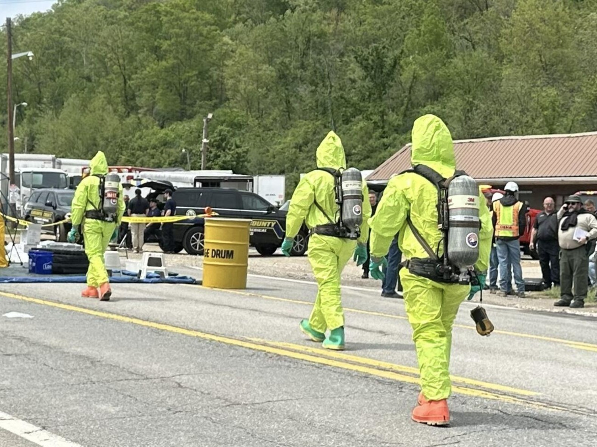
:::

::: {.checklist-content}
**Initial approach to the incident scene**

- Avoid committing or positioning personnel in a hazardous position.
- Assess the situation first and have an escape route in case conditions suddenly deteriorate.
:::
:::

::: {.checklist-item}
::: {.checklist-image}
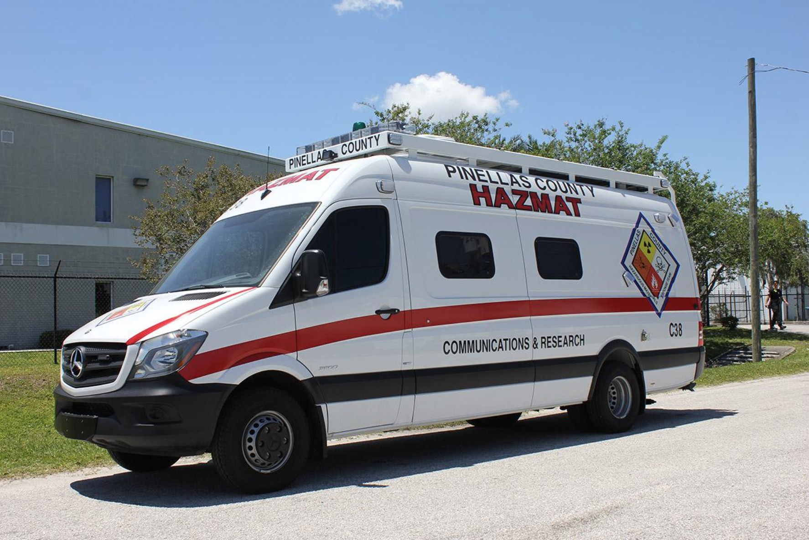
:::

::: {.checklist-content}
**Incident command**

- Establish command of the incident and establish an incident command post (ICP).
- If other public safety units are already on scene, make sure operations are coordinated and unified.
:::
:::

::: {.checklist-item}
::: {.checklist-image}
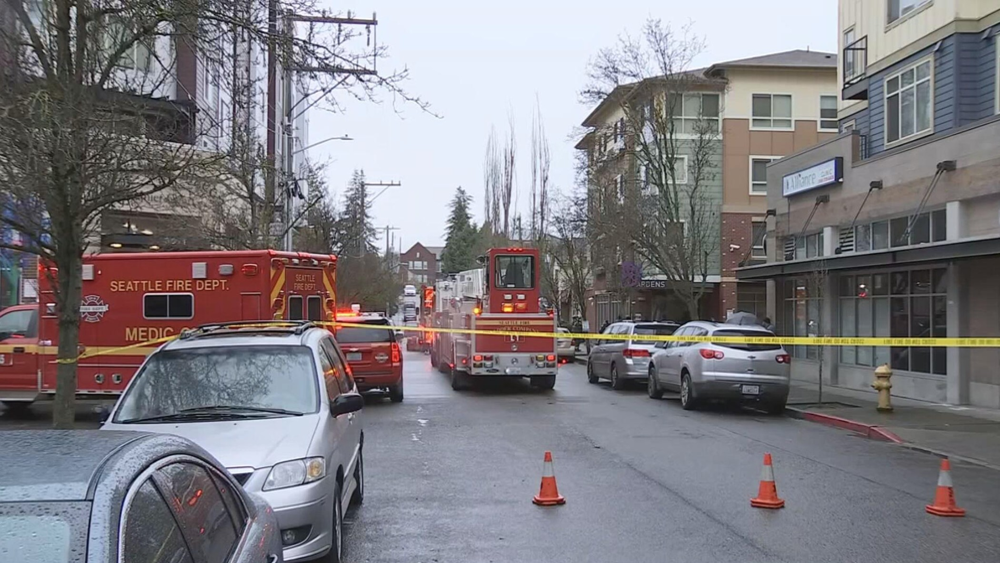
:::

::: {.checklist-content}
**Staging and perimeter control**

- Establish a staging area (Level I, II) for additional responding equipment and personnel.
- Establish an isolation perimeter (i.e., outer perimeter) to isolate the area and deny entry.
- Establish access control and traffic control points.
- Restrict emergency site access to authorized essential personnel only.
- All nonessential personnel should be isolated from the problem.
- Isolation perimeters should include areas of land, water, and air.
:::
:::

::: {.checklist-item}
::: {.checklist-image}
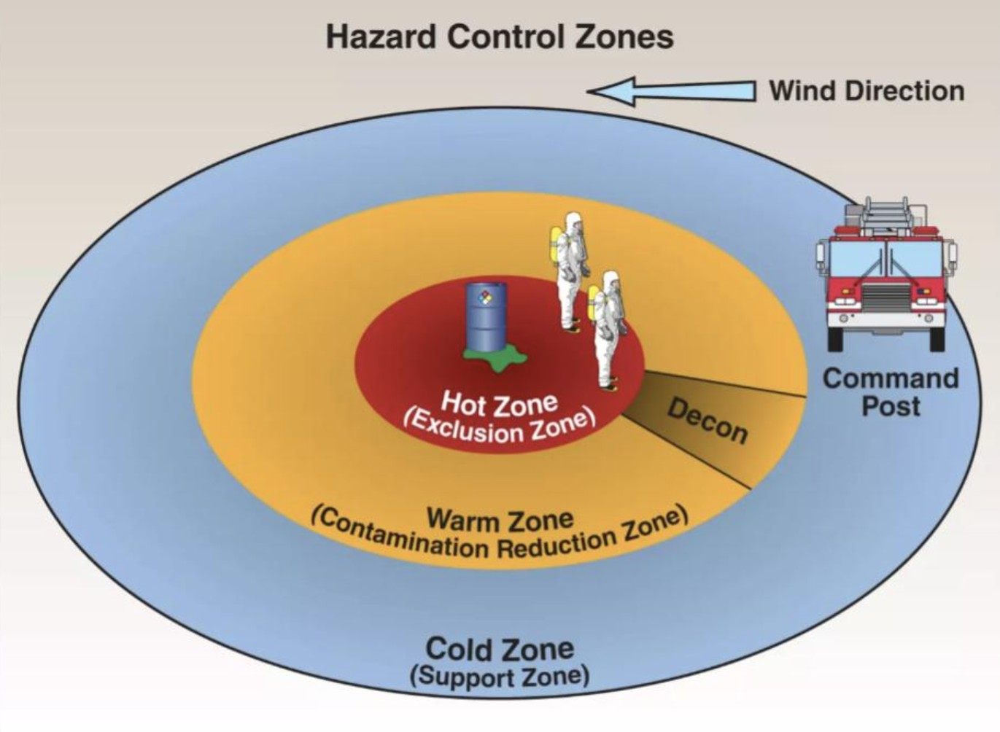
:::

::: {.checklist-content}
**Hot zone establishment**

- Establish a hot zone or inner perimeter as the "playing field."
- Identify and communicate to all personnel the location of the hot zone.
- Methods of identifying the restricted area include visible landmarks, barricade tape, and traffic cones.
:::
:::

::: {.checklist-item}
::: {.checklist-image}
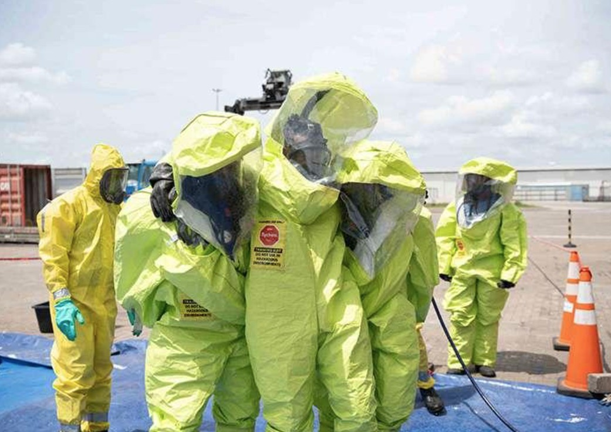
:::

::: {.checklist-content}
**Personal protective equipment**

- Enter the area only with the appropriate level of respiratory and skin protection for the hazards present.
- If victims are down, self-contained breathing apparatus (SCBA) is the minimum level of respiratory protection for initial emergency response operations.
- Depending on the situation and materials involved, structural firefighting clothing may not provide sufficient personal protection.
:::
:::

::: {.checklist-item}
::: {.checklist-image}
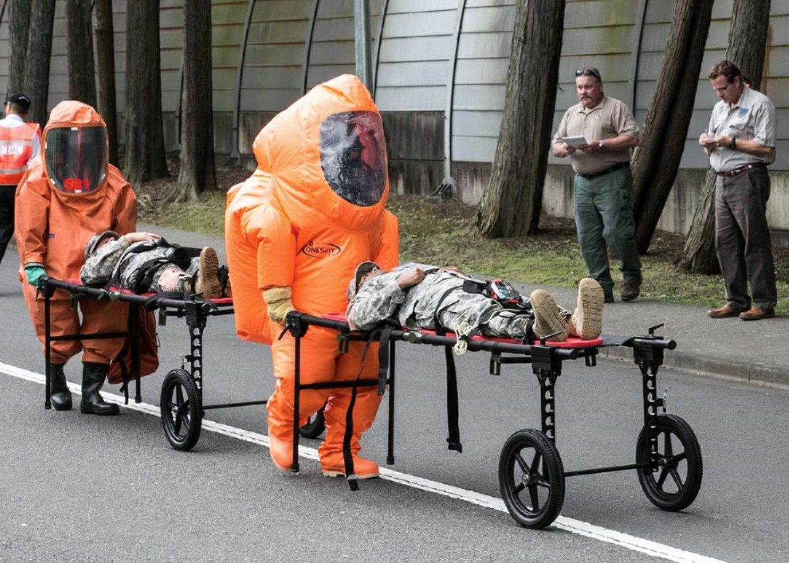
:::

::: {.checklist-content}
**Public protective actions**

- If civilians are injured and you suspect personal contamination, isolate all personnel until emergency decon can be established.
- Initiate public protective actions.
:::
:::

::: {.callout-note title="Caution"}
Emergency responders must be aware that certain chemical releases can travel throughout the scene and impact response routes.

Some chemicals can create vapor clouds that could be mistaken for fog or other normal weather and environmental conditions (e.g., anhydrous ammonia, liquefied petroleum gas, or LPG).

**The danger area may extend beyond the visible vapor cloud.**
:::

::: {.callout-important title="Operational Considerations"}

- **Establish the playing field:** Site management establishes the playing field for the players (responders) and the spectators (everyone else).

- **Initial response timeline:**
  - The first 10 minutes of the incident determines operations for the next 60 minutes.
  - The first 60 minutes determines operations for the next 8 hours.

- **Maintain manageable boundaries:** Don't attempt to establish an isolation perimeter larger than responders can effectively secure and control. A smaller, well-controlled perimeter may be more effective than a larger, poorly controlled one.

- **Remember the basics:** The more time, distance, and shielding between you and the material, the lower the risk will be. Don't get the stuff on you!

- **Emergency evacuation:** Designate an emergency evacuation signal and identify rally points for emergency evacuation.

- **Hot zone operations:** Remember the first law of hot zone operations when dealing with hazardous materials. To play in the game you must:
  - Be trained to play.
  - Be dressed to play.
  - Have a buddy system with a backup capability (minimum of two-in/two-out).
  - Have decon established.
  - Coordinate with command and safety.

:::

---


## Step 2: Identify the Problem

### Function

Identify the **scope and nature of the problem**. This includes:

- Recognition, identification, and verification of the hazmat/WMD involved in the incident.
- Type of container, as applicable.
- Exposures.

Methods of identification include:

- Analyzing container shapes, markings, labels and placards, and facility documents (e.g., pre-incident plans, Tier 2 reporting forms, Safety Data Sheets, or SDS).
- Using monitoring and detection equipment.
- Using the senses (i.e., physical observations, smell, reports from victims, etc.).

Responders should remember that even when the hazardous substances have been initially identified, **the information should always be verified**

### Goal

**Identify the scope and nature of the problem**, including the type and nature of hazardous materials involved.


### Checklist

::: {.checklist-item}
::: {.checklist-image}
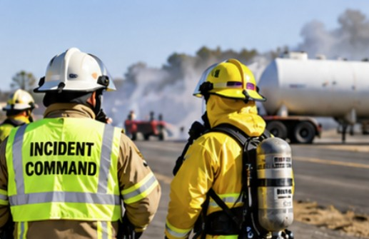{lightbox=true}
:::

::: {.checklist-content}
**Survey the incident**

- Identify the nature and severity of the immediate problem, including:
  - Recognition, identification, and verification of the material(s) involved.
  - Type of container involved.
  - Any potential or existing life hazards.
- If multiple problems exist, prioritize them and make independent assignments.
:::
:::

::: {.checklist-item}
::: {.checklist-image}
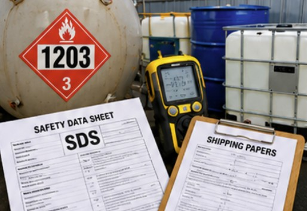{lightbox=true}
:::

::: {.checklist-content}
**Clues for identifying hazardous materials**

- Occupancy and location.
- Container shapes.
- Markings and colors.
- Placards and labels.
- Shipping papers or facility documents.
- Monitoring and detection equipment.
- Senses, including physical observations, smell, and so on.
:::
:::

::: {.checklist-item}
::: {.checklist-image}
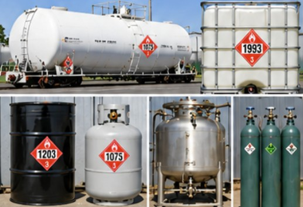{lightbox=true}
:::

::: {.checklist-content}
**Container characteristics**

Factors to consider in assessing the type of container involved include:

- Bulk versus nonbulk.
- Pressurized versus nonpressurized.
- Number of compartments.
- Material(s) of construction.
- Container valves, piping, and pressure relief devices.
:::
:::

::: {.checklist-item}
::: {.checklist-image}
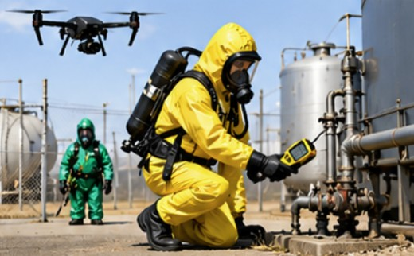{lightbox=true}
:::

::: {.checklist-content}
**Reconnaissance**

- Conduct offensive or defensive reconnaissance (recon), as necessary, to gather intelligence on the situation.
:::
:::


::: {.callout-important title="Operational Considerations"}

- **A problem well defined is half solved.**

- **Verify initial information:** Assume initial information may be incomplete or incorrect. Always verify your initial information.

- **Conduct reconnaissance operations:** Recon can include:

  - **Defensive Recon:** Objective is to obtain information on site layout, containers, physical hazards, access, and other related conditions from beyond the inner perimeter. This is normally obtained through threat assessments, interviews, physical observations, use of unmanned aerial vehicles (UAVs), and so on.

  - **Offensive Recon:** Objective is to obtain intelligence and incident information by physically entering the inner perimeter. At incidents that involve both hazmat and explosive risks, this may be a joint-entry operation with both bomb squad and hazmat personnel to conduct monitoring, sampling, and video or photo documentation for analysis or evidence.

- **Be alert for secondary events and improvised explosive devices (IEDs).** IED clues can include:

  - Abandoned container out of place for the surroundings.
  - Obvious explosive device components, such as batteries, timers, blasting caps, charges, and wires taped to containers.
  - Trip wires, motion sensors, or partially exploded devices.
  - Unusual or foreign devices attached to hazmat containers, especially liquefied and compressed gas cylinders, flammable liquid containers, and bulk storage tanks and vessels.
  - Unattended vehicles not appropriate to the immediate environment.

:::

---


## Step 3: Hazard Assessment and Risk Evaluation

### Function

This is **the most critical function that emergency responders perform**.

The primary objective of risk evaluation is to determine:

1. **Whether responders should intervene.**
2. **What strategies and tactics should be used to control the problem.**

It is critical to get this right. If you do not have the expertise to do this adequately, get help from someone who does (e.g., local hazardous materials response teams [HMRTs] and product/container technical specialists).

### Goal

**Assess the hazards present, evaluate the level of risk, and develop an incident action plan (IAP)** to make the problem go away.

### Checklist

::: {.checklist-item}

::: {.checklist-image}
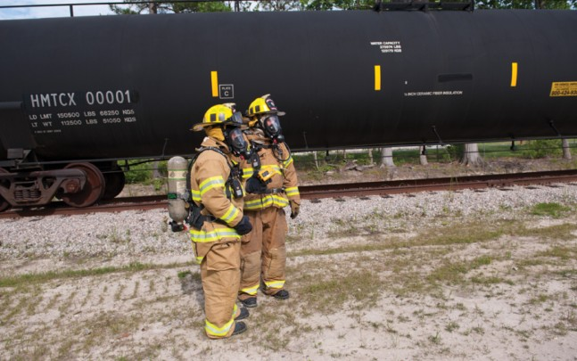{lightbox=true}
:::

::: {.checklist-content}
**Assess the hazards**

- Assess the hazards posed by the problem, including:
  - Health hazards.
  - Physical hazards.
  - Chemical hazards.
  - Weapons.
  - Other hazards.
:::

:::

::: {.checklist-item}

::: {.checklist-image}
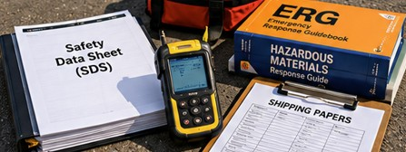{lightbox=true}
:::

::: {.checklist-content}
**Collect and evaluate hazard information**

Collect, prioritize, and manage hazard data and information from all sources, including:

- Technical reference manuals.
- Technical information sources.
- Hazmat databases.
- Technical information specialists.
- Safety Data Sheets (SDS).
- Monitoring and detection equipment.
:::

:::

::: {.checklist-item}

::: {.checklist-image}
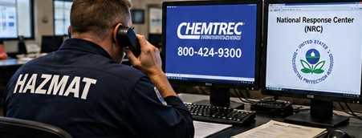{lightbox=true}
:::

::: {.checklist-content}
**Consult technical information centers**

Primary technical information centers available to public safety personnel include:

- CHEMTREC: (800) 424-9300.
- National Response Center (NRC), which serves as the federal single point of contact for accessing federal assistance.
- State single point of contact.
- Product or container specialists.
- State and regional poison control centers.
:::

:::

::: {.checklist-item}

::: {.checklist-image}
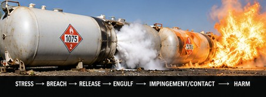{lightbox=true}
:::

::: {.checklist-content}
**Evaluate hazardous materials behavior**

Air monitoring and the General Hazmat Behavior Model are critical in implementing a risk-based response process.

Understand the relationship and behaviors between the container and the hazmat(s) involved:

- Stress.
- Breach.
- Release.
- Engulf.
- Impingement/contact.
- Harm.

::: {.callout-note title="Understanding Impingement"}

In hazmat operations, **impingement** is **the direct contact made by a released hazardous material with people, property, or the environment**.

It is measured by duration and categorized into short-term (seconds to hours), medium-term (days to months), and long-term (months to years) contact.

**Duration Categories**

- **Short-Term Impingement:** Lasts from seconds to hours; typically involves immediate acute exposure or rapid-release events.

- **Medium-Term Impingement:** Lasts from days to months; involves ongoing contamination or residual environmental presence.

- **Long-Term Impingement:** Lasts from months to years (or generations); involves deep soil, groundwater, or structural integration.

*Source: [Event — Impinge: Hazmat Behavior Model](https://vabeachfireacademy.blogspot.com/2017/01/event-impinge-hazmat-behavior-model.html).*

:::

:::

:::

::: {.checklist-item}

::: {.checklist-image}
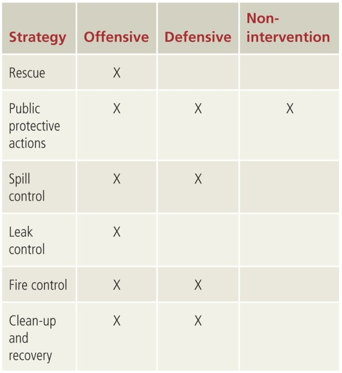{lightbox=true}
:::

::: {.checklist-content}
**Develop the incident action plan (IAP)**

Based on the risk evaluation process, develop your IAP.

Determine whether the incident should be handled offensively, defensively, or by nonintervention.

Remember that **offensive tactics increase the risks to emergency responders**.

- **Offensive mode/tactics:** Require responders to control or mitigate the emergency from within the area of high risk.

- **Defensive mode/tactics:** Permit responders to control or mitigate the emergency from outside the area of highest risk.

- **Nonintervention mode/tactics:** Implement a passive response posture until additional personnel or equipment arrive, or allow the fire to burn itself out.
:::

:::

::: {.callout-important title="Operational Considerations"}

- **Focus on what you can change:** Focus on the things you can change and that will have a positive impact on the outcome.

- **Evaluate the value of intervention:** Every incident will have an outcome, with or without your help. If you cannot change the outcome in a positive way, why get involved? Doing nothing and letting the incident take its course without intervention may be a viable option.

- **Balance risk and potential benefit:** There is nothing wrong with taking a risk. If there is much to be gained, there is much to be risked. If there is little to be gained, then little should be risked.

- **Be a risk evaluator:** When hazmats are involved, public safety personnel should see their roles as risk evaluators rather than risk takers. Good risk evaluators come home. Bad ones don't.

- **Hour-one priorities within the IAP:**
  - Establish site management and control.
  - Identify the materials/agents involved.
  - Ensure the safety of all personnel from all hazards.
  - Ensure personal protective equipment (PPE) is appropriate for the hazards.
  - Initiate strategies and tactics to accomplish initial rescue, decon, medical, and public protective action needs.

- **Preserve potential evidence:** If criminal activities are involved (e.g., terrorism incidents), maintain the integrity of potential evidence.

- **Remember the PACE model of planning:**
  - **Primary:** Primary plan.
  - **Alternate:** Alternate plan.
  - **Contingency:** Contingency plan(s) based upon contingent scenarios.
  - **Emergency:** Emergency plan if responders must immediately evacuate the area.

:::

---


## Step 4: Select Personal Protective Clothing and Equipment

### Function

Based on the results of the hazard and risk evaluation process, **select the proper level of personal protective clothing and equipment**.

Two primary types of personal protective clothing used at hazmat incidents are:

- Structural firefighting protective clothing.
- Chemical-protective clothing.

### Goal

**Ensure all emergency response personnel have the appropriate level of personal protective clothing and equipment (skin and respiratory protection)** for the expected tasks.


### Checklist

::: {.checklist-item}

::: {.checklist-image}
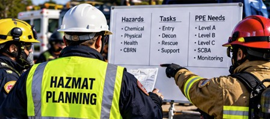{lightbox=true}
:::

::: {.checklist-content}
**Evaluate PPE selection factors**

The selection of personal protective clothing will depend on the hazards and properties of the materials involved and the response objectives to be implemented (i.e., offensive, defensive, or nonintervention).

In evaluating the use of specialized protective clothing, the following factors must be considered:

- **Hazards:** The hazard to be encountered, including the specific tasks to be performed. If victims are present, their signs and symptoms can provide clues that will influence the selection of PPE.
- **Tasks:** The tasks to be performed (e.g., entry, decon, support).
- **Protection:** The level and type of specialized protective clothing to be used.
- **Responder capabilities:** The capabilities of the individual(s) who will use the PPE in a hostile environment. Remember, specialized protective clothing places a great deal of both physiological and psychological stress on the wearer.
:::

:::

::: {.checklist-item}

::: {.checklist-image}
{lightbox=true}
:::

::: {.checklist-content}
**Ballistic-protective clothing**

- Protects against specific ballistic threats.
- Helps absorb the impact and/or reduce or stop penetration of bullets and steel fragments from handheld weapons and exploding munitions.
:::

:::

::: {.checklist-item}

::: {.checklist-image}
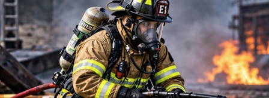{lightbox=true}
:::

::: {.checklist-content}
**Structural firefighting protective clothing**

Includes:

- Helmet.
- Fire-retardant hood.
- Turnout coat and pants.
- Personal alert safety system (PASS device).
- Gloves.

**Positive-pressure self-contained breathing apparatus (SCBA)** is the minimum level of respiratory protection described for this ensemble.
:::

:::

::: {.checklist-item}

::: {.checklist-image}
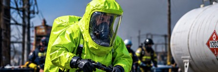{lightbox=true}
:::

::: {.checklist-content}
**Chemical vapor-protective clothing**

Specialized chemical-protective clothing used with air-supplied respiratory protection devices.

- Offers a sealed, integrated level of full-body protection from hostile environments.
- Primarily designed to protect against chemical gases and vapors.
- Provides total-body splash protection.

It may also be referred to as **EPA Level A chemical-protective clothing** or **NFPA 1991-compliant clothing**.
:::

:::

::: {.checklist-item}

::: {.checklist-image}
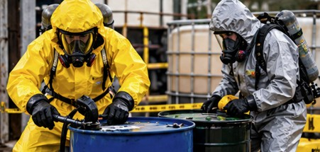{lightbox=true}
:::

::: {.checklist-content}
**Chemical splash-protective clothing**

Specialized protective clothing that protects against chemical liquid splashes but not against chemical vapors or gases.

It is mainly designed to provide personal protection against:

- Liquid splashes.
- Solids.
- Dusts.
- Particles.

It can be found in both single- and multipiece garment ensembles.

It is also called:

- **EPA Level B chemical-protective clothing** when air-supplied respiratory protection is provided.
- **EPA Level C chemical-protective clothing** when air-purifying respirators (APR) are provided.

Its design and chemical resistance may also be referred to as **NFPA 1992- or NFPA 1994-compliant clothing**, depending on the garment, its design, and chemical resistance.
:::

:::

::: {.callout-important title="Operational Considerations"}

- **Verify appropriate PPE:** Ensure that all emergency response personnel are using the proper protective clothing and equipment for the present hazards.

- **CBRN protection:** If the incident involves chemical, biological, radiological, and nuclear (CBRN) agents, ensure both skin and respiratory protection provide the required level of personal protection.

- **Avoid unsafe positioning:** Do not place personnel in an unsafe emergency situation or location.

- **Request additional resources early:** Order additional personnel, specialized equipment, and technical expertise early in the incident. If you are unsure of your incident needs, call for the highest level of assistance available. Do not wait to call for emergency assistance. It is always better to have too much than not enough.

- **Limitations of structural firefighting clothing:** Remember that structural firefighting protective clothing is not designed to protect against chemical hazards.

- **Chemical and thermal protection:** With some notable exceptions, it can be hard to effectively combine chemical and thermal protection.

- **Heat stress:** Wearing any type and level of impermeable protective clothing creates the potential for heat stress injuries.

- **Last line of defense:** Personal protective clothing is not your first line of defense. **It is your last line of defense!**

:::

---


## Step 5: Information Management and Resource Coordination

### Function

Refers to the proper **management, coordination, and distribution of all relevant data and information within the Incident Command System (ICS)** at the scene.

This function cannot be effectively accomplished unless a unified ICS organization is in place.

The ability to determine the incident factors involved, which functions of the Eight Step Process® have been completed, what additional information must be obtained, and what incident factors remain unknown are especially important.

### Goal

**Quickly and efficiently coordinate and distribute all relevant data, information, and resources** among all of the players.


### Checklist

::: {.checklist-item}

::: {.checklist-image}
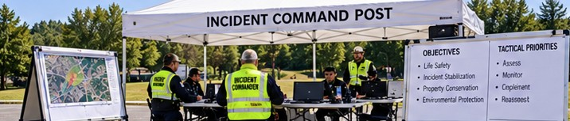{lightbox=true}
:::

::: {.checklist-content}
**Confirm incident command post (ICP) safety**

- Confirm the ICP is in a safe area.
:::

:::

::: {.checklist-item}

::: {.checklist-image}
{lightbox=true}
:::

::: {.checklist-content}
**Establish unified command and agency coordination**

- Confirm that:
  - A unified command organization is in place.
  - All assisting and cooperating agencies are represented directly or through the liaison officer.
:::

:::

::: {.checklist-item}

::: {.checklist-image}
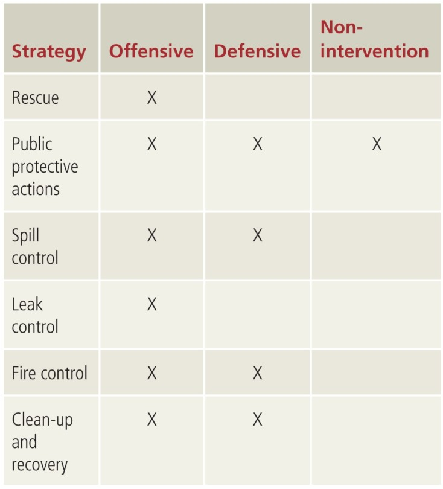{lightbox=true}
:::

::: {.checklist-content}
**Expand the Incident Command System (ICS)**

- Expand the ICS and create additional branches, divisions, or groups within the operations section, as needed.
:::

:::

::: {.checklist-item}

::: {.checklist-image}
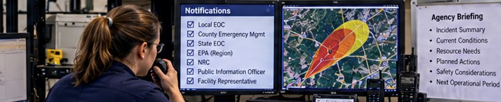{lightbox=true}
:::

::: {.checklist-content}
**Coordinate notifications and information sharing**

- Ensure all appropriate internal and external notifications have been made.
- Coordinate information and brief other agencies as needed.
:::

:::

::: {.checklist-item}

::: {.checklist-image}
{lightbox=true}
:::

::: {.checklist-content}
**Communicate safety procedures and emergency orders**

- Ensure safety procedures are part of all tactical briefings.
- Confirm emergency orders and take steps to make sure they are fully understood and correctly followed.
- Keep strict control of the situation.
:::

:::

::: {.checklist-item}

::: {.checklist-image}
{lightbox=true}
:::

::: {.checklist-content}
**Monitor incident progress and coordinate additional resources**

- Make sure there is continuing progress toward solving the emergency.
- Do not wait to call for additional assistance if conditions appear to be deteriorating.
- If activated, regularly update the local/facility emergency operations center (EOC).
:::

:::


::: {.callout-note title="Incident Command Post (ICP) Considerations"}

Personnel not directly involved in the overall command and control of the incident should be removed from the ICP area.

:::

::: {.callout-important title="Operational Considerations"}

- **Secure incident response areas:** Consider the security of the ICP and all other incident response areas (e.g., staging, rehabilitation).

- **Plan ahead:** Don't look unprepared because you didn't have a plan.

- **Communicate problems early:** Bad news doesn't get better with time. The earlier you know about a problem and communicate that information, the sooner you can start to fix it. Don't let the incident commander be the last to know!

- **Prevent freelancing:** Don't allow external resources to freelance or develop their own plan. Freelancing can happen at both the individual and organizational levels.

- **Establish the planning section early:** Don't let your lack of a planning section become the Achilles' heel of your response. Establish the planning section early, especially if the incident has the potential to become a campaign event.

- **Activate logistics when needed:** Operations may win battles, but logistics wins wars. Incidents that have specialized or substantial resource needs require the logistics section to be activated as early as possible.

:::

---


## Step 6: Implement Response Objectives

### Function

This is the phase where emergency responders **apply the best available strategies and tactics to ensure the most favorable outcome**.

If the incident is in the emergency phase, this is where we make the problem go away.

Common strategies to protect people and stabilize the problem include:

- Rescue.
- Public protective actions.
- Spill control.
- Leak control.
- Fire control.
- Clean-up and recovery operations.

These strategies are typically implemented by fire, rescue, and hazardous materials units, whereas law enforcement is usually responsible for all security and criminal-related issues.

In the post-emergency response phase, response personnel will likely focus on scene safety, clean-up, evidence preservation, and incident investigation.

Specific tasks will include:

- Initial site entry and monitoring to determine the extent of the hazards present.
- An evaluation of the scene to locate evidence that can be used to reconstruct the events leading up to the incident.
- Identification of the factors that contributed to the cause of the incident.
- Interviewing on-scene personnel and witnesses to verify the information obtained and opinions formed based on the available data.
- Documentation of preliminary results.

### Goal

**Ensure incident priorities (i.e., rescue, incident stabilization, environmental and property protection) are accomplished in a safe, timely, and effective manner.**


### Checklist

::: {.checklist-item}

::: {.checklist-image}
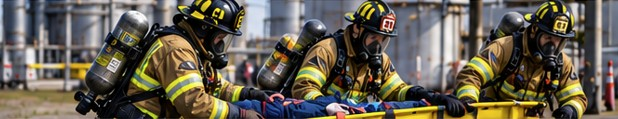{lightbox=true}
:::

::: {.checklist-content}
**Rescue**

- Implement response objectives involving rescue.
:::

:::

::: {.checklist-item}

::: {.checklist-image}
{lightbox=true}
:::

::: {.checklist-content}
**Public protective actions**

- Implement response objectives involving public protective actions.
:::

:::

::: {.checklist-item}

::: {.checklist-image}
{lightbox=true}
:::

::: {.checklist-content}
**Spill control**

- Implement response objectives involving spill control.
:::

:::

::: {.checklist-item}

::: {.checklist-image}
{lightbox=true}
:::

::: {.checklist-content}
**Leak control**

- Implement response objectives involving leak control.
:::

:::

::: {.checklist-item}

::: {.checklist-image}
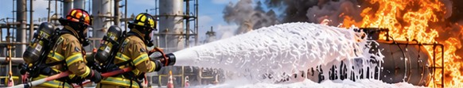{lightbox=true}
:::

::: {.checklist-content}
**Fire control**

- Implement response objectives involving fire control.
:::

:::

::: {.checklist-item}

::: {.checklist-image}
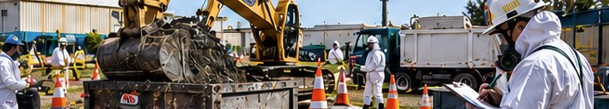{lightbox=true}
:::

::: {.checklist-content}
**Clean-up and recovery operations**

- Implement response objectives involving clean-up and recovery operations.
:::

:::

::: {.checklist-item}

::: {.checklist-image}
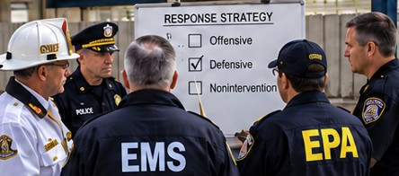{lightbox=true}
:::

::: {.checklist-content}
**Select and implement response tactics**

Implement response objectives.

Remember that **offensive tactics increase the risks to emergency responders**. Evaluate the risks of offensive control tactics before sending emergency response crews into the hazard area.

- **Offensive tactics:** Require responders to control or mitigate the emergency from within the area of high risk.

- **Defensive tactics:** Permit responders to control or mitigate the emergency from outside the area of highest risk.

- **Nonintervention tactics:** Implement a passive response posture until additional personnel or equipment arrive, or allow the fire to burn itself out.
:::

:::


:::

::: {.callout-note title="Tactical Flexibility"}

Rapidly changing incident conditions may require using multiple tactics simultaneously or switching from one tactic to another.

**Defensive tactics are always desirable over offensive tactics if they can accomplish the same objectives.**

:::

### Entry Operations and Personnel Safety

- Ensure backup personnel are properly equipped with the appropriate level of personal protective clothing and are in place before initiating operations.

- Ensure any detection or monitoring equipment is operational and properly calibrated.

- Ensure entry teams have been briefed before they are allowed to enter the hot zone.

For hazmat emergencies, entry team briefings should include:

- Removal of all watches, jewelry, and personal valuables (e.g., wallets, cell phones).
- Objectives of the entry operation.
- Known hazards within the area, including physical hazards (e.g., downed power lines, stairwells, open pits).
- Safety procedures, including medical, radio communications, SCBA, and PPE checks.
- Emergency procedures, including placement of backup teams, escape signals, and escape corridors.
- Decon area location, set-up, and procedures.

Conduct regular monitoring of the hazard area to determine if conditions are changing.

::: {.callout-note title="Caution"}

**Decon should be set up before initiating entry operations.**

For situations where civilians are down and chemical exposures are suspected, establish emergency decon as soon as possible.

:::

::: {.callout-important title="Operational Considerations"}

- **Evaluate nonintervention:** What will happen if I do nothing? Remember, this is the baseline for hazmat decision making and should be the scenario against which all strategies and tactics are compared.

- **Positive-pressure ventilation:** Positive-pressure ventilation can be used to:
  - Significantly reduce chemical vapor levels in a building.
  - Increase the safety of emergency responders who must enter a structure to perform rescue operations.

  Keep exposure hazards downwind, if applicable.

- **Illicit laboratory operations:** Never touch or handle anything in an illicit lab operation until the area has been cleared by bomb squad personnel. This includes surveying and identifying the area for possible booby traps.

- **Energetic materials:** There is a very fine line between explosives, oxidizers, and organic peroxides. All can release large amounts of energy.

- **Maintain contingency plans:** Surprises are nice on your birthday but not on the emergency scene. **Always have a Plan B in case Plan A doesn't work!**

:::

---


## Step 7: Decon and Clean-Up Operations

### Function

**Decontamination is the process of making personnel, equipment, and supplies safe by reducing or eliminating harmful substances (i.e., contaminants)** in contaminated areas (i.e., hot zone or inner perimeter).

Decon is commonly viewed in terms of cleaning personnel and equipment after entry operations. However, there are situations where, due to the type of materials involved, decon of clothing and equipment may not be possible and items may require disposal.

All personnel trained to the first responder operations level should be able to perform or deliver an emergency decon capability.

At most working hazmat incidents, hazardous materials response teams (HMRTs) or fire and rescue units working under the direction of a hazmat technician will provide technical decon services.

Questions about disposal methods and procedures should be directed to environmental officials and technical specialists, based on applicable federal, state, and local regulations.

### Goal

**Ensure the safety of both emergency responders and the public** by reducing:

1. The level of contamination on scene.
2. The potential for secondary contamination beyond the incident scene.


### Checklist

::: {.checklist-item}

::: {.checklist-image}
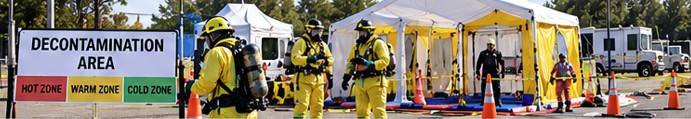{lightbox=true}
:::

::: {.checklist-content}
**Coordinate decontamination with tactical operations**

- Ensure technical decon operations are coordinated with tactical operations.
- Properly locate the decon area within the warm zone, preferably upslope and upwind of the incident location.
:::

:::

::: {.checklist-item}

::: {.checklist-image}
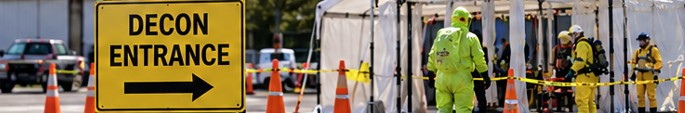{lightbox=true}
:::

::: {.checklist-content}
**Clearly mark and identify the decon area**

- Clearly mark and identify the decon area.
:::

:::

::: {.checklist-item}

::: {.checklist-image}
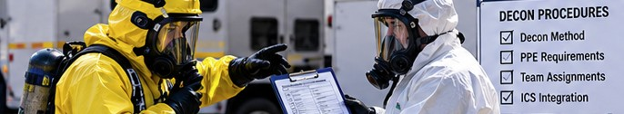{lightbox=true}
:::

::: {.checklist-content}
**Determine decon method, PPE, and integrate with ICS**

- Determine and communicate the proper decon method and type of personal protective clothing to be worn by the decon team, as appropriate.
- Integrate all decon operations with the ICS organization.
:::

:::

::: {.checklist-item}

::: {.checklist-image}
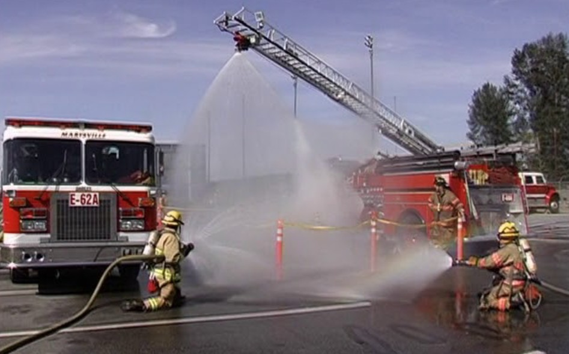{lightbox=true}
:::

::: {.checklist-content}
**Establish mass decontamination operations**

Incidents involving large numbers of contaminated or potentially contaminated people require the establishment of a mass decon operation.

Basic principles of mass casualty decon include:

- Expect a five-to-one ratio of unaffected to affected casualties. For every victim who is physically contaminated, five others may be exposed or think they are contaminated.
- Decontaminate as soon as possible. You may need to corral contaminated people until a mass decon corridor is established.
:::

:::

::: {.checklist-item}

::: {.checklist-image}
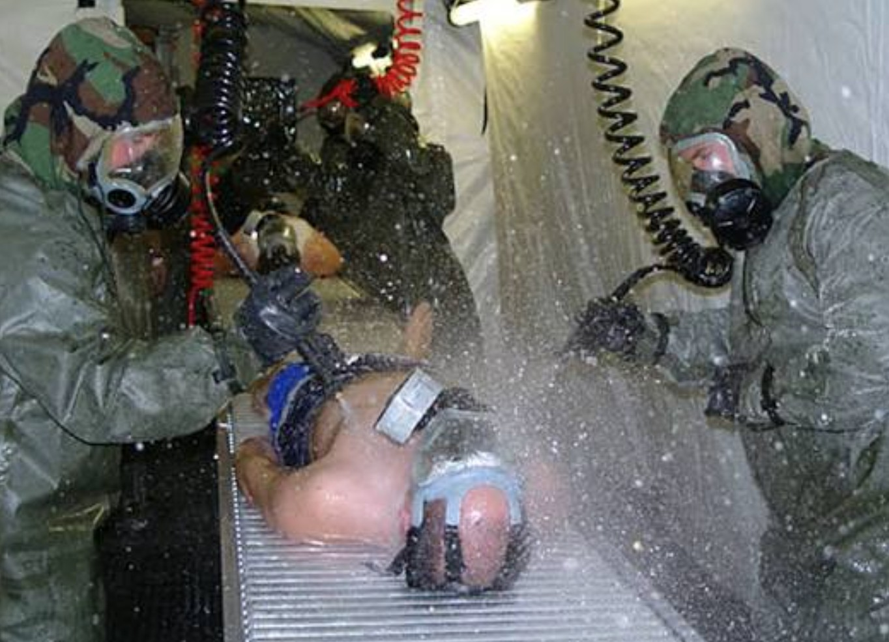{lightbox=true}
:::

::: {.checklist-content}
**Implement effective decontamination procedures**

- Disrobing is decon. Undress from top to bottom—more is better.
- Water flushing for 3 minutes is usually the best mass decon method.
- After a known exposure to a hazmat, responders must decon as soon as possible to avoid serious effects.
:::

:::

::: {.checklist-item}

::: {.checklist-image}
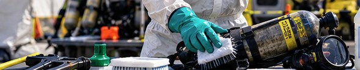{lightbox=true}
:::

::: {.checklist-content}
**Clean up or dispose of contaminated supplies and equipment**

- Ensure proper decon of all personnel before they leave the scene. For example, flammable gases and some toxic and corrosive gases can saturate protective clothing and be carried into safe areas.
- Establish a plan to clean up or dispose of contaminated supplies and equipment before cleaning up the site of a release.
- Federal and state laws require proper disposal of hazardous waste.
:::

:::

::: {.checklist-item}

::: {.checklist-image}
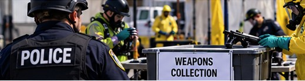{lightbox=true}
:::

::: {.checklist-content}
**Address special considerations**

- Establish an emergency decon capability as part of the incident action plan for hazmat incidents.
- Ensure personnel and contaminated victims are decontaminated before leaving the scene.
- Address law enforcement and security concerns during decon operations.
:::

:::


::: {.callout-important title="Responder Tips"}

- **Emergency decon planning:** Establishing an emergency decon capability should be part of the incident action plan for any hazmat incident (e.g., illicit labs, special weapons and tactics [SWAT] tactical operations).

- **Mass decon challenges:** Decon involving large numbers of people will be a challenge and will make for a long day. Remember the basics: separate the people from the problem and keep them contained until mass decon is established. It won't be easy, and it can get ugly.

- **Permeation:** Permeation can occur with any porous material (e.g., shoes, belts, fire hose, holsters, gun stocks), not just PPE.

- **Sodium hypochlorite:** Sodium hypochlorite (i.e., bleach) may be used as a decon agent for equipment when dealing with chemical and biological materials. Be aware that bleach will degrade some materials (e.g., Kevlar™) and will shorten the life of the material.

- **Skin exposure:** Degradation chemicals, such as bleach, should never be applied directly to the skin.

- **Medical transport:** Never transport contaminated victims from the scene to any medical facility without conducting field decon. At best, healthcare workers will be mad at you. At worst, you will endanger other people and completely shut down the emergency room of the hospital.

- **Law enforcement considerations:** Law enforcement operations at incidents where hazmats are involved can create some unique challenges:
  - Be aware that suspects may be among civilians during mass decon operations.
  - Make sure all weapons are properly handled and made safe by establishing a weapons safety officer as part of decon.
  - Ensure security procedures are in place when conducting decon of contaminated prisoners.

:::

---


## Step 8: Terminate the Incident

### Function

This is the **termination of emergency response activities and the beginning of post-emergency response operations (PERO)**.

This includes:

- Investigation.
- Restoration.
- Recovery activities.

It also includes the transfer of command to the agency that will be responsible for coordinating all post-emergency activities.

### Goal

**Ensure overall command is transferred to the proper agency** when:

1. The emergency is terminated.
2. All post-incident administrative activities are completed per local policies and procedures.


### Checklist

::: {.checklist-item}

::: {.checklist-image}
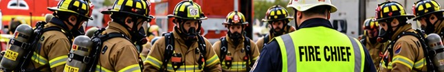{lightbox=true}
:::

::: {.checklist-content}
**Account for all personnel**

- Account for all personnel before securing emergency operations.
:::

:::

::: {.checklist-item}

::: {.checklist-image}
{lightbox=true}
:::

::: {.checklist-content}
**Conduct incident debriefings**

- Conduct incident debriefing sessions for on-scene response personnel.
- Provide background information needed to ensure the documentation of any exposures.
:::

:::

::: {.checklist-item}

::: {.checklist-image}
{lightbox=true}
:::

::: {.checklist-content}
**Transfer command**

- Ensure command is formally transferred from the lead response agency to the lead agency for all post-emergency response operations.
:::

:::

::: {.checklist-item}

::: {.checklist-image}
{lightbox=true}
:::

::: {.checklist-content}
**Communicate remaining hazards**

- Ensure public safety units are aware of any hazards remaining at the incident scene if emergency responders must return to the scene.
:::

:::

::: {.checklist-item}

::: {.checklist-image}
{lightbox=true}
:::

::: {.checklist-content}
**Document incident operations**

Ensure the following elements are documented:

- All operational, regulatory, and medical phases of the emergency.
- All equipment and supplies used during the incident.
- The contact information (e.g., names, phone numbers, email addresses) of all key players. This includes contractors, public officials, and members of the media.
:::

:::

::: {.checklist-item}

::: {.checklist-image}
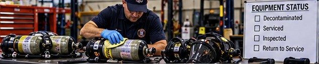{lightbox=true}
:::

::: {.checklist-content}
**Restore emergency equipment**

Ensure all emergency equipment is:

- Decontaminated.
- Reserviced.
- Inspected.
- Placed back in service.
:::

:::

::: {.checklist-item}

::: {.checklist-image}
{lightbox=true}
:::

::: {.checklist-content}
**Provide a post-incident point of contact**

- Provide a point of contact for all post-incident questions and issues.
:::

:::

::: {.checklist-item}

::: {.checklist-image}
{lightbox=true}
:::

::: {.checklist-content}
**Conduct an incident critique**

- Conduct a critique of all major and significant incidents based on local protocols.
:::

:::


::: {.callout-important title="Responder Tips: Learning from Incident Critiques"}

- **Avoid assigning blame:** Although organizations tend to develop their own critique styles and processes, never use a critique to assign blame. Public meetings are the worst time to discipline personnel.

- **Focus on operational improvement:** Organizations must balance the potential negatives against the benefits of the critique process. The purpose of critiques is to improve your operations.

- **Three common approaches to incident critiques:**

  1. We lie to each other about what a great job we just did.
  2. We beat up each other for making mistakes.
  3. We focus on the lessons learned and the changes/improvements we must make to our response system.

**The objective is to identify lessons learned and improve future emergency response operations.**

:::


---

## Application Example

### Incident Scenario: Suspected Illicit Drug Laboratory

You are a regional hazmat officer who has been requested to respond to an incident involving a suspected illicit drug laboratory.

Both fire service and law enforcement personnel are already on scene, and a suspected lab operator is now under arrest.

The suspected laboratory is located on the third floor of a four-story multifamily (i.e., garden apartment) building.

At this time, no entry operations have taken place, and emergency responders are in the process of developing their incident action plan (IAP).

As the hazmat officer, both fire and law enforcement leadership are looking for recommendations on how to proceed.

### 1. What are your incident objectives?

Your incident objectives might include:

- Ensuring the safety of responders and the public.
- Mitigating the illicit laboratory problem and its potential extension to other apartments and throughout the apartment building.
- Coordinating support to law enforcement and environmental agencies in investigating and mitigating the illicit laboratory problem.
- Coordinating evacuation and shelter operations.
- Coordinating information and intelligence gathering to all key stakeholders.

### 2. What are your incident priorities?

Your incident priorities might include:

- Life safety.
- Incident stabilization.
- Property and environmental protection.
- Critical infrastructure disruption.

### 3. What are your tactical priorities?

Your tactical priorities might include:

- Assessing the specific nature of the problem, including the type of illicit laboratory and the hazardous materials and types of containers present.
- Assessing the presence of potential booby traps, including weapons, chemicals, and explosives.
- Containing the hazmat problem in the involved apartment, including control of utilities and building systems, to minimize migration to other unaffected areas.
- Evacuating the occupants and establishing shelter operations, as necessary.

### 4. Identify any additional resources or specialized units that might be required as part of entry and control operations.

Additional resources or specialized units that might be required include:

- Emergency medical services (EMS) units to support both responders and civilian personnel.
- Bomb technician or bomb squad unit.
- Environmental crimes unit and/or environmental protection agency (local, state, or federal).
- Environmental clean-up contractor.
- Local emergency management agency representatives to coordinate evacuation and sheltering operations.

---

## Wrap-Up

### Summary

Emergency response operations at incidents involving hazardous materials must always be based on a **structured and standardized system of response protocols and procedures**.

No matter the nature of the incident, the response, or the personnel involved, standardized procedures:

1. Bring consistency to tactical operations.
2. Improve the delivery of a risk-based operational response capability.

If the situation may involve hazardous materials or weapons of mass destruction (WMD) agents, standardized tactical response procedures will help minimize the risk of exposure to all responders.

The **Eight Step Process®** is a tool used for the tactical management of hazardous materials emergencies. It serves as an example of a structured system that can be used by response personnel at incidents.

While the level of equipment, training, and personnel may vary among organizations, there are basic functions and tasks that must be consistently evaluated and applied at hazardous materials incidents.

The Eight Step Process® provides the framework to translate planning and preparedness into the delivery of an effective system for responding to incidents where hazardous materials and WMDs may be involved.

### The Eight Functions of the Eight Step Process®

The eight functions within the Eight Step Process® are:

1. **Site management and control**
2. **Identify the problem**
3. **Hazard assessment and risk evaluation**
4. **Select personal protective clothing and equipment**
5. **Information management and resource coordination**
6. **Implement response objectives**
7. **Decon and clean-up operations**
8. **Terminate the incident**


---

::: {.text-center}

**© 2026 Yoni Rodriguez. All rights reserved.**

*SHM 377 — Hazardous Materials Management*  
Central Washington University

*Instructional organization, original illustrations, and supplemental educational materials developed by Yoni Rodriguez.*

*Adapted instructional content and the Eight Step Process® are attributed to Hazardous Materials: Managing the Incident, Jones & Bartlett Learning. Original publisher rights remain with their respective owners.*

:::
