---
format:
  html:
    toc: true
    toc-location: right
    toc-depth: 3
    smooth-scroll: true
    code-fold: true
    embed-resources: true
    self-contained-math: true
    html-math-method: katex
    lightbox: auto
  pdf:
    toc: true
    documentclass: scrartcl
    geometry:
      - margin=0.75in
    fontsize: 11pt
editor: visual
execute:
  echo: false
  warning: false
  message: false
---

```{=html}
<style>
/* =========================================================
   SHM 377 Lecture Styling
   ========================================================= */

body {
  color: #212529;
}

blockquote {
  color: #212529;
  font-size: inherit;
  font-style: normal;
  font-weight: normal;
}

blockquote strong {
  color: #212529;
}

.text-center {
  color: #212529;
}

/* =========================================================
   Lecture Cover
   ========================================================= */

.cover-image img {
  width: 100%;
  height: 300px;
  object-fit: cover;
  object-position: center;
}

.cover-image p {
  margin-bottom: 0;
}

/* =========================================================
   Scientific Evidence Callout
   ========================================================= */

.evidence-callout {
  background-color: #f2f3f5;
  border-left: 4px solid #737980;
  border-radius: 4px;
  padding: 1rem 1.25rem;
  margin: 1.5rem 0;
  color: #212529;
}

.evidence-callout h2 {
  font-size: 1.15rem;
  margin-top: 0;
  color: #343a40;
}

/* =========================================================
   Mobile
   ========================================================= */

@media (max-width: 768px) {
  .columns {
    display: block !important;
  }

  .columns > .column {
    width: 100% !important;
    max-width: 100% !important;
    flex: 0 0 100% !important;
  }

  .columns > .column:empty {
    display: none !important;
  }

  img {
    max-width: 100%;
    height: auto;
  }

  .cover-image img {
    height: auto;
  }

  p, li, figcaption {
    overflow-wrap: anywhere;
  }
}


/* Compact scientific evidence callout */

.evidence-callout {
  background-color: #f2f3f5;
  border-left: 3px solid #737980;
  border-radius: 4px;
  padding: 0.55rem 0.75rem;
  margin: 0.5rem 0 0;
  color: #212529;
  font-size: 0.82rem;
  line-height: 1.35;
}

.evidence-callout h2 {
  font-size: 0.95rem;
  font-weight: 600;
  margin: 0 0 0.4rem;
  color: #343a40;
}

.evidence-callout p {
  margin: 0 0 0.45rem;
}

.evidence-callout p:last-child {
  margin-bottom: 0;
}


/* =========================================================
   Chemical equations: responsive KaTeX display
   Keep equations readable on narrow mobile screens.
   ========================================================= */
.katex-display {
  max-width: 100%;
  overflow-x: auto;
  overflow-y: hidden;
  padding: 0.5rem 0;
  margin: 1rem 0;
  -webkit-overflow-scrolling: touch;
}

.katex-display > .katex {
  white-space: nowrap;
}

@media (max-width: 768px) {
  .katex-display > .katex {
    font-size: 0.9em;
  }
}

</style>
```

::::::: {.columns style="align-items: flex-start;"}
:::: {.column width="46%"}
::: cover-image
.](NASA-monkey-head-nebula.jpg){fig-alt="NASA Hubble Space Telescope photograph of the Monkey Head Nebula, showing illuminated clouds of interstellar gas and dust surrounded by stars"}
:::
::::

::: {.column width="4%"}
:::

::: {.column width="50%"}
## SHM 377: Hazardous Materials Management

### Chemistry of Hazardous Materials: Solids

**Lecture 03 · Fall 2026**

Yoni Rodriguez\
Engineering Technologies, Safety, and Construction\
Central Washington University\
[Yoni.Rodriguez\@cwu.edu](mailto:Yoni.Rodriguez@cwu.edu)
:::
:::::::

------------------------------------------------------------------------

# Introduction: From Matter to Solids

In Lecture 02, we learned how to classify matter and distinguish between physical and chemical properties. We also discussed John Dalton and how scientists use observations to understand things they cannot directly see.

In this lecture, we will focus on **solids** and explore how their physical and chemical properties influence their behavior and potential hazards.

Our goal is not to become chemists, but to **think like chemists** when investigating hazardous materials.

::: callout-note
## Our reasoning framework

**Observe → Explain → Predict → Decide**

For any hazardous material, ask: **What has happened? What will or could happen? What can you change?**
:::

## Learning objectives

By the end of this lecture, you should be able to:

1.  Describe how the physical characteristics of solids affect their behavior.
2.  Distinguish a bulk solid from a powder, dust, or airborne particulate.
3.  Identify important physical and chemical hazards associated with solids.
4.  Explain how temperature, mechanical disturbance, and contact with other substances can change a hazard scenario.
5.  Identify evidence and information needed before recommending controls.

# 1. What Is a Solid?

A **solid** is a state of matter that ordinarily maintains its shape and volume under specified conditions. Its constituent particles are held in relatively fixed positions or structures, although they continue to move at the microscopic scale.

The word *solid* describes a **physical state of matter**. It does not tell us about a substance's **chemical properties** or whether it is hazardous.

Examples encountered in hazardous materials management include metal ingots, crystalline chemicals, fertilizer granules, contaminated soil, asbestos-containing materials, and powdered metals.

| Form | What we can observe | Why it matters |
|------------------------|------------------------|------------------------|
| Bulk solid | Large piece or consolidated mass | Contact, handling, heat transfer, and mechanical damage |
| Pellets | Relatively large, often uniformly shaped pieces of compressed or manufactured material | Spillage, handling, and possible fragmentation |
| Granules | Smaller, discrete grains or particles, often irregular in shape | Spreading, spillage, and potential dust generation |
| Powder | Many small, loose particles | Ease of dispersion, contact area, and potential inhalation |
| Airborne dust or particles | Small solid particles suspended in air | Inhalation exposure, deposition, and, for some materials, fire or explosion |

::: callout-important
## The same material can present different hazards in different forms

A solid block and a cloud of fine particles may have the same chemical composition but very different opportunities for exposure or reaction.
:::

# 2. What Can We Learn from Particle Size?

## Dust Generation and Transport

Activities such as cutting, sanding, crushing, pouring, sweeping, or moving materials can produce airborne particles.

Once particles are airborne, their movement depends on factors including:

- Particle size, shape, and density.
- Air movement and ventilation.
- How the particles were released.
- How long the particles remain airborne or whether they become airborne again.

::: callout-note
## Remember

Just because we cannot see particles in the air does not mean they are not there.

Likewise, seeing smoke or dust does not tell us exactly how much is present.

**Scientists use instruments to measure airborne particles.**
:::

## Poll Everywhere: Can a Tree Become Hazardous?

Imagine a tree growing in a forest.

:::::: {.columns .poll-layout}
::: {.column width="68%"}
**Question 1: Under ordinary conditions, would you classify a living tree as a hazardous material?**

- A. Yes
- B. No
- C. It depends on the circumstances

Use the same Poll Everywhere response page throughout this activity.
:::

::: {.column width="4%"}
:::

::: {.column .poll-qr width="28%"}
{fig-alt="QR code to join the SHM 377 Poll Everywhere presentation" width="250"}
:::
::::::

### From a Tree to Wildfire Smoke

Under ordinary conditions, we would not classify a living tree itself as a hazardous material.

However, what happens when that tree catches fire?

**Question 2: What happens to wood when it burns?**

- A. It only changes its physical appearance.
- B. It undergoes a chemical reaction that produces new substances.
- C. It disappears without producing anything.
- D. It changes directly from a solid into a gas without a chemical reaction.

When wood burns, it undergoes a chemical reaction called **combustion**.

Combustion changes the original material and produces new substances.

Wildfire smoke is a mixture that can contain:

- **Fine airborne particles**, including solid particles and liquid droplets.
- **Gases**, including carbon monoxide.
- **Volatile organic compounds (VOCs)**, which we will discuss in a later lecture.

### Connecting Chemistry to Human Health

**Question 3: How can wildfire smoke affect human health?**

- A. Smoke is only hazardous when we can see it.
- B. Smoke can enter the respiratory system and expose us to harmful particles and gases.
- C. Smoke is only hazardous when someone touches burning wood.
- D. Smoke cannot cause harm because wood is a natural material.

::: callout-note
## How and Why Does Wildfire Smoke Affect Human Health?

Wildfire smoke can present serious health hazards. The potential for harm depends on factors such as the amount of smoke in the air, the duration of exposure, and individual susceptibility.

This raises two important questions:

**HOW does wildfire smoke enter the human body?**

**WHY can wildfire smoke cause harm?**

To answer these questions, we first need to understand the size of particles in smoke and what happens when we breathe them in.
:::

------------------------------------------------------------------------

## Historical Context: When Air Pollution Becomes a Community Hazard

:::::: {.columns style="align-items: flex-start;"}
::: {.column width="49%"}
### Donora, Pennsylvania: 1948

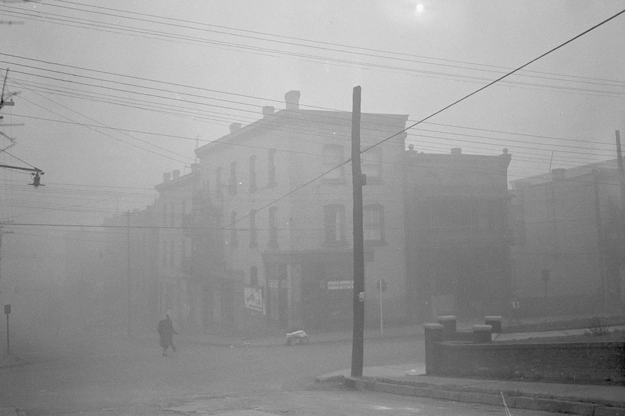{#fig-donora width="100%"}

Between October 27 and October 31, 1948, Donora experienced one of the most serious air-pollution disasters in United States history.

Nearby zinc and steel production facilities released industrial pollutants, including:

- **Sulfur dioxide (SO₂)**
- **Hydrogen fluoride (HF)**
- **Particulate matter**

A **temperature inversion** trapped polluted air near the ground, limiting normal atmospheric dispersion.

The consequences were severe:

- **20 deaths** attributed to the initial episode.
- Additional deaths reported afterward.
- **Thousands of residents became ill.**
:::

::: {.column width="2%"}
:::

::: {.column width="49%"}
### Spokane, Washington: 2017

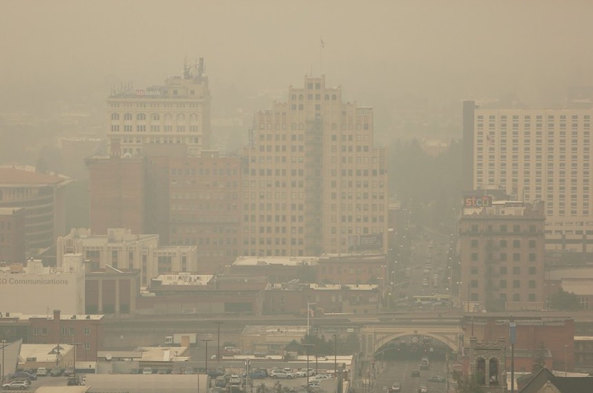{#fig-spokane-smoke width="100%"}

During the summer of 2017, wildfire smoke affected communities throughout Eastern Washington, including Spokane.

Unlike Donora's industrial pollution, Spokane experienced smoke transported from regional wildfires.

Wildfire smoke contains a mixture of:

- **Fine airborne particles**
- **Gases, including carbon monoxide**
- **Volatile organic compounds (VOCs)**

On September 7, 2017, Spokane recorded an **Air Quality Index (AQI) of 256**, categorized as **Very Unhealthy**, according to the historical data presented in Yoni Rodriguez's undergraduate research presentation in 2019.

The event demonstrated that smoke can affect communities located far from the original fires.
:::
::::::

### Comparing the Two Events

| Characteristic | Donora (1948) | Spokane (2017) |
|------------------------|------------------------|------------------------|
| **Pollution source** | Zinc and steel facilities | Regional wildfires |
| **Environmental conditions** | Temperature inversion limited dispersion | Atmospheric winds transported smoke |
| **Geographic impact** | Donora and the surrounding valley | Spokane and Eastern Washington |
| **Health concerns** | Severe illness and deaths | Respiratory and cardiovascular health risks |
| **Important lesson** | Pollutants can accumulate near their source | Pollutants can travel far from their source |

### Understanding Temperature Inversions

Under typical daytime atmospheric conditions, warmer air near the ground can rise and mix with cooler air above it. This vertical movement helps disperse airborne pollutants.

A **temperature inversion** occurs when a layer of warmer air lies above cooler air near the ground.

The warmer layer limits vertical mixing, allowing pollutants to accumulate in the cooler air below.

.](thermal-inversion.jpg){#fig-temperature-inversion width="90%" fig-align="center" lightbox="true"}

**Connecting the diagram to Donora (1948):**

- **Pollution source:** Industrial facilities continuously released airborne contaminants.
- **Atmospheric conditions:** A temperature inversion limited vertical mixing and dispersion.
- **Geography:** The surrounding valley further contributed to the accumulation of polluted air.
- **Exposure:** Residents inhaled elevated concentrations of pollutants over several days.

**Important:** A temperature inversion does not create the pollutants. It changes how pollutants disperse and can increase their concentrations near the ground.

::: callout-note
## Understanding Airborne Hazards

Both events demonstrate that hazardous airborne contaminants can affect entire communities.

When investigating an airborne hazard, we need to ask:

1.  **What is in the air?** Identify the pollutants.
2.  **How much is present?** Measure their concentrations.
3.  **How do pollutants move?** Consider wind, weather, and geography.
4.  **How can people be exposed?** Identify potential routes of exposure.
:::

------------------------------------------------------------------------

## What does particle size tell us about exposure?

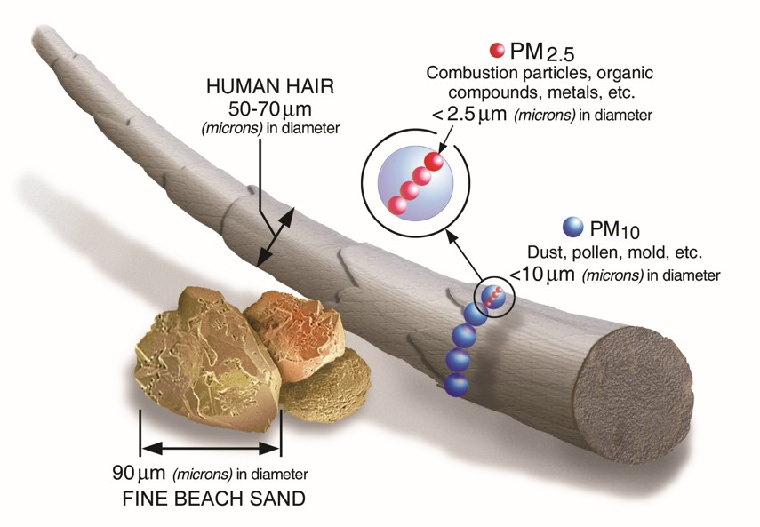{#fig-pm-size width="90%" fig-align="center"}

**Particulate matter (PM)** consists of particles suspended in air. The presentation introduces particle-size categories:

- **PM10:** particles with aerodynamic diameters of 10 micrometers (µm) or smaller.
- **PM2.5:** fine particles with aerodynamic diameters of 2.5 µm or smaller.
- **PM1:** particles with aerodynamic diameters of 1 µm or smaller. **PM1 is not synonymous with ultrafine particles**; ultrafine particles are generally defined as smaller than 0.1 µm.

A **micrometer** is one-millionth of a meter. As the illustration shows, a human hair is typically tens of micrometers across, much wider than an individual PM2.5 particle. The size categories overlap: PM2.5 is included within PM10. **PM2.5 identifies a size fraction, not one specific chemical or toxic substance.**

Small particles may remain suspended and travel with air currents. Their behavior depends on aerodynamic diameter, density, shape, humidity, and atmospheric conditions. Particle size also affects where inhaled particles may deposit within the respiratory tract.

------------------------------------------------------------------------

## How can inhaled particles affect the lungs?

Li and colleagues (2003) investigated how exposure to particulate matter can affect cells involved in the lungs' immune response.

The electron micrographs below show experimental macrophage-like cells exposed to different particle-size fractions. **Macrophages** are immune cells that help recognize and remove foreign material, including inhaled particles.

::::::: {.columns style="align-items: flex-start;"}
::: {.column width="43%"}
### Understanding the Micrographs

**🟩 Green: No PM exposure**

- Reference cells without added particulate exposure.
- Used to compare changes in cellular structures.

**🟨 Yellow: PM10 exposure (coarse fraction)**

- Cells exposed to a coarser particulate fraction.
- The images show changes in cellular structures.

**🟧 Orange: PM2.5 exposure (fine fraction)**

- Cells exposed to a finer particulate fraction.
- Particles and cellular changes are visible near mitochondria.

**🟥 Red: PM1 exposure (smaller particles)**

- Cells exposed to a smaller particulate fraction.
- Changes in mitochondrial structures, including the **cristae**, are visible.
:::

::: {.column width="3%"}
:::

:::: {.column width="54%"}
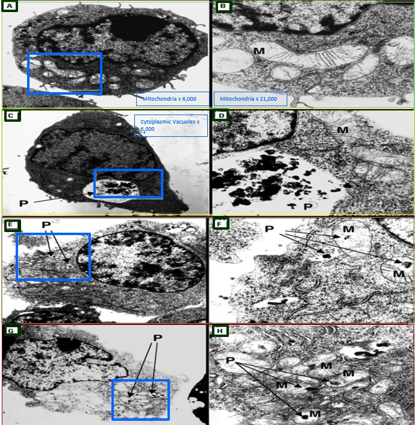{#fig-pm-lung width="100%" lightbox="true"}

::: evidence-callout
## Interpreting the Evidence

These images come from an **experimental cell study**, not lung tissue collected from people exposed to Washington wildfire smoke.

They illustrate possible biological mechanisms of particulate toxicity.

**Particle size matters, but chemical composition also influences toxicity.**
:::
::::
:::::::

### Why Do These Changes Matter?

**Mitochondria** are structures inside cells that help produce energy.

The folds inside mitochondria are called **cristae**. These folds are important for normal mitochondrial function.

Certain particulate exposures can contribute to the production of **reactive oxygen species (ROS)**.

ROS are chemically reactive molecules that can damage cellular structures when produced in excess. This process is called **oxidative stress**.

The study helps illustrate how particulate exposure may contribute to cellular injury and inflammation.

------------------------------------------------------------------------

### How Do Particles Reach These Cells?

**A simplified exposure pathway:**

1.  Airborne particles are **inhaled**.
2.  Depending on particle size and breathing conditions, some deposit in the airways or reach the **alveoli**, the small air sacs where oxygen enters the bloodstream.
3.  Particles can interact with lung cells and immune cells, including **alveolar macrophages**.
4.  Certain particle exposures can trigger **oxidative stress and inflammatory responses**.

**Think like a chemist:** Why do we need to know both **particle size** and **chemical composition** before predicting toxicity?

## Can inhaled particles affect the cardiovascular system?

Miller and colleagues (2017), in *Inhaled Nanoparticles Accumulate at Sites of Vascular Disease*, investigated whether inhaled nanoparticles could move beyond the lungs and enter the bloodstream.

The researchers used **inhaled gold nanoparticles as experimental tracers**, allowing them to investigate the movement of particles through the body by measuring gold in biological samples.

### Introducing Biomonitoring

**Biomonitoring** is the measurement of chemicals, their metabolites, or other exposure-related markers in biological samples, such as blood or urine.

Biomonitoring can help scientists determine whether a substance has entered the body and investigate how its measured concentration changes over time.

In this study, researchers collected blood samples at multiple time points following inhalation exposure.

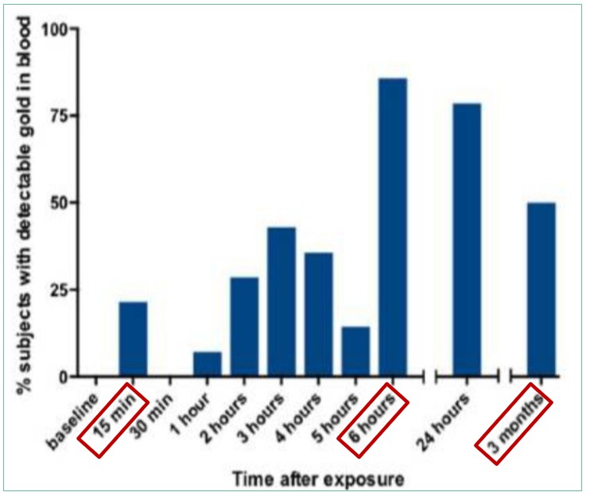{#fig-pm-heart width="85%" fig-align="center" lightbox="true"}

### Why Does Sampling Time Matter?

Examine the graph carefully.

- **15 minutes:** Gold was detectable in the blood of some participants.
- **30 minutes:** The graph shows a temporary decrease to 0% detection.
- **Later measurements:** Gold was detected again in participants' blood.
- **24 hours:** Gold was detectable in \~86%.

**Does the 30-minute result mean that the gold nanoparticles had completely disappeared from the body?**

**No.**

::: evidence-callout
## Interpreting the Evidence

The researchers were measuring extremely small quantities of gold. Their analytical method had two important thresholds:

- **Limit of Detection (LOD):** The smallest amount of a substance that an analytical method can reliably distinguish from background. In this study, approximately **0.01 ng/g of blood**.
- **Limit of Quantification (LOQ):** The smallest amount of a substance that an analytical method can reliably measure quantitatively. In this study, approximately **0.03 ng/g of blood**.

**A measurement below the detection limit does not necessarily mean that the substance is absent.**

The researchers explained that nanoparticles may gradually move from the lungs into circulation while physiological processes distribute or remove them from the blood.

Consequently, the amount detectable in a blood sample may change over time.

The graph shows the **percentage of participants with detectable gold**, not the gold concentration in each participant's blood. It cannot establish the precise mechanism responsible for changes in detection.

**Key takeaway:** A single biological sample may not adequately characterize exposure or the movement of a substance through the body. Biomonitoring results must be interpreted alongside sampling time, analytical detection limits, and biological processes.
:::

### What Does This Tell Us About Cardiovascular Health?

Miller and colleagues (2017) provided evidence that **some inhaled nanoparticles can translocate from the lungs into systemic circulation**.

Their research also investigated the accumulation of inhaled nanoparticles at sites of vascular disease.

Inhaled particulate pollution can also affect the cardiovascular system through **inflammation originating in the lungs, oxidative stress, and physiological signaling**, even when particles do not directly enter the bloodstream.

**Think like a chemist:** If you collected only one blood sample at 30 minutes, how might your interpretation differ from a study that collected samples over 24 hours?

# 3. What Makes a Solid Hazardous?

The **physical state alone does not determine the hazard**. We must consider the substance's identity, chemical properties, particle characteristics, amount, and conditions.

## Toxic or harmful particulates

Some solid particles can enter the body by **inhalation**, while other exposure routes may include ingestion or contact with skin or eyes.

Examples worth investigating include:

:::::::: {.columns style="align-items: flex-start;"}
::: {.column width="32%"}
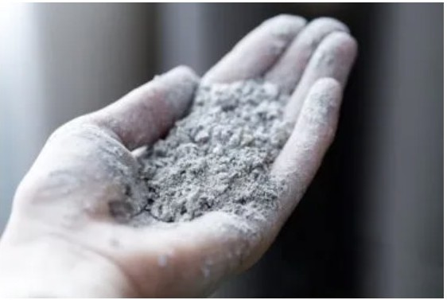{width="100%" height="160px" fig-align="center" lightbox="true"}

**Respirable crystalline silica**

Generated during some cutting or grinding of silica-containing materials.

Inhalation of respirable crystalline silica can damage the lungs and cause diseases such as **silicosis**.
:::

::: {.column width="2%"}
:::

::: {.column width="32%"}
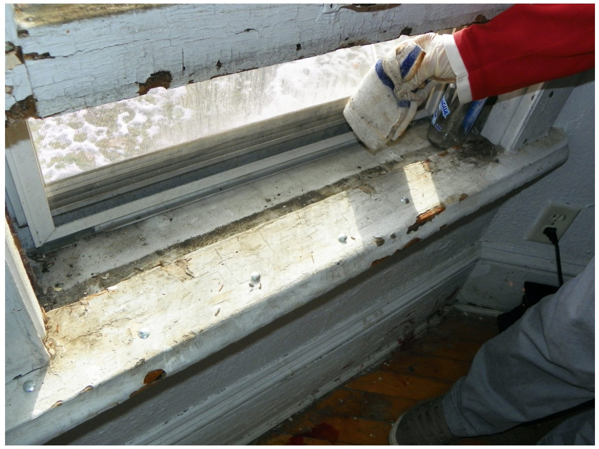{width="100%" height="160px" fig-align="center" lightbox="true"}

**Lead-containing dust**

May be produced when lead-containing coatings or materials are disturbed.

Exposure can cause **systemic toxicity**, affecting multiple organs and body systems.
:::

::: {.column width="2%"}
:::

::: {.column width="32%"}
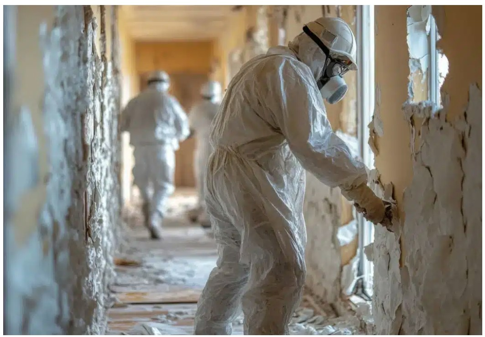{width="100%" height="160px" fig-align="center" lightbox="true"}

**Asbestos fibers**

Can be released when certain asbestos-containing materials are disturbed.

Inhalation presents serious long-term health risks, including **asbestosis, lung cancer, and mesothelioma**.
:::
::::::::

**Think like a chemist:** These materials can all produce airborne hazards, but their **chemical composition, particle size, shape, and biological behavior** differ.

Do not assume that all dusts have the same toxicity, or that the absence of visible dust means exposure is absent.

## Combustible dust

Certain finely divided combustible solids can burn rapidly when dispersed in air. Under appropriate conditions, a dust cloud can create a **flash fire or explosion hazard**.

Examples include some organic dusts, such as flour or wood dust, and certain metal powders. Whether a specific dust is explosible requires substance-specific evaluation.

A useful screening framework is the **dust explosion pentagon**:

1.  **Combustible dust (fuel)**
2.  **Oxygen**
3.  **Ignition source**
4.  **Dispersion of dust in air**
5.  **Confinement or sufficient congestion for damaging pressure development**

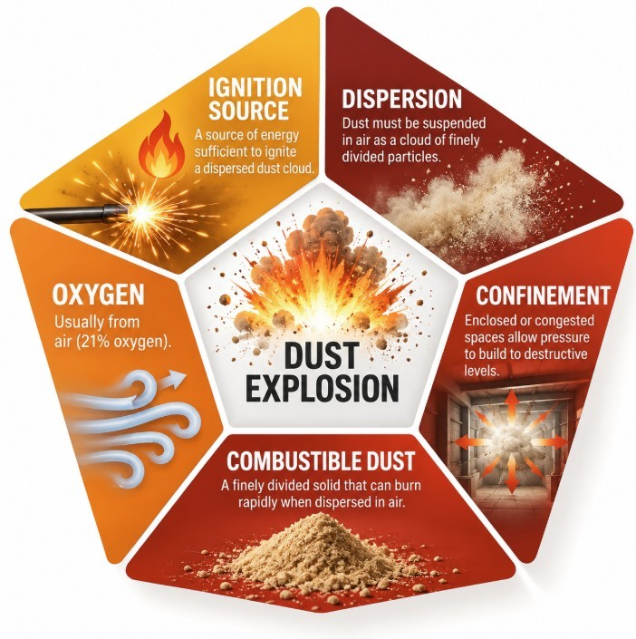{#fig-dust-explosion-pentagon width="55%" fig-align="center" lightbox="true"}

Removing or controlling one or more necessary conditions can reduce the hazard.

### Combustible Dust: Video Example

The following video provides an opportunity to examine how combustible dust hazards can develop.



**Think like a chemist:** As you watch, consider which conditions of the dust explosion pentagon are present.

- What is the potential **fuel**?
- How might the dust become **dispersed in air**?
- What could provide an **ignition source**?
- How might the surrounding environment influence the consequences?

**Safety reminder:** Never create a dust cloud to test whether it burns.

**Video:** [Watch on YouTube](https://youtu.be/Jg7mLSG-Yws)

## Reactive solids

Some solids may react dangerously with **water, air, oxidizers, acids, or other incompatible materials**. These reactions may produce heat, fire, or hazardous gases.

However, not all solids or metals react in the same way.

### Potassium: A Water-Reactive Metal

**Potassium (K)** is an alkali metal with an atomic number of 19.

In its elemental form, potassium is a soft, silvery-white solid that reacts readily with moisture and oxygen.

Potassium metal is especially hazardous because it can react violently with water, generating heat, corrosive potassium hydroxide, and flammable hydrogen gas.

The reaction can be represented by the following balanced chemical equation:

$$
2K(s) + 2H_2O(l) \rightarrow 2KOH(aq) + H_2(g)
$$

**What does this reaction tell us?**

- **K:** Potassium metal is the reactive solid.
- **H₂O:** Water is a reactant, not a safe extinguishing agent for a potassium metal fire.
- **KOH:** Potassium hydroxide is a highly corrosive product.
- **H₂:** Hydrogen is a flammable gas that may ignite if sufficient heat is generated.

The reaction releases considerable heat, which can ignite the hydrogen and potassium metal.

### Potassium Reactivity: Video Example

The following video illustrates the behavior of potassium under reactive conditions.



**Video:** [Watch on YouTube](https://youtu.be/oqMN3y8k9So)

### Why Does Chemical Compatibility Matter?

Potassium demonstrates why emergency responders must understand the **chemical properties and incompatibilities** of a hazardous material before selecting a response method.

Potassium metal can:

- **React violently with water**, generating heat and flammable hydrogen.
- **Ignite in air**, particularly under certain surface and environmental conditions.
- **React with oxidizers and other incompatible substances**, potentially causing fires or violent reactions.
- **Cause severe chemical burns** through the formation of corrosive potassium hydroxide when it contacts moisture.

**Important:** Water and carbon dioxide extinguishers are inappropriate for potassium metal fires. Specialized extinguishing agents suitable for combustible metals are required, and response decisions must follow the substance-specific Safety Data Sheet and established emergency procedures.

------------------------------------------------------------------------

## Poll Everywhere: Understanding Oxidation and Reduction

Before introducing oxidation and reduction reactions, let's assess our familiarity with these concepts.

**This is not a graded quiz.** The purpose is to understand your previous chemistry experience and identify concepts we should spend more time discussing.

:::::: {.columns style="align-items: flex-start;"}
::: {.column width="68%"}
### Question 1: Familiarity with REDOX

**Before today, how familiar were you with the term REDOX reaction?**

- A. I have never heard the term.
- B. I have heard it but cannot explain it.
- C. I recognize oxidation and reduction, but not REDOX.
- D. I understand REDOX and can explain it.
- E. I have applied these concepts in chemistry or work.

### Question 2: Chemical Equation Confidence

**How confident are you in interpreting a balanced chemical equation, such as the formation of iron(III) oxide shown below?**

$$
4Fe + 3O_2 \rightarrow 2Fe_2O_3
$$

- A. Not confident at all
- B. Slightly confident
- C. Moderately confident
- D. Confident
- E. Very confident

### Question 3: Oxidation

**In chemistry, what does oxidation mean?**

- A. A substance gains electrons.
- B. A substance loses electrons.
- C. A substance always catches fire.
- D. A substance changes from a solid to a gas.
- E. I'm not sure.

### Question 4: Reduction

**In chemistry, what does reduction mean?**

- A. A substance loses electrons.
- B. A substance becomes physically smaller.
- C. A substance gains electrons.
- D. A substance loses heat.
- E. I'm not sure.

### Question 5: Rust Formation

**When exposed to oxygen and moisture, why does unprotected iron develop rust?**

- A. Iron undergoes a chemical reaction that forms new substances.
- B. Iron only changes color without reacting.
- C. Iron melts when exposed to air.
- D. Water removes the iron's atoms without a chemical reaction.
- E. I'm not sure.

### Question 6: Hazardous Materials Management

**Why is understanding oxidation and reduction useful in hazardous materials management?**

- A. It helps explain corrosion, combustion, and oxidizer hazards.
- B. It tells us the exact toxicity of every chemical.
- C. It eliminates the need for Safety Data Sheets.
- D. It only applies to laboratory experiments.
- E. I'm not sure.
:::

::: {.column width="4%"}
:::

::: {.column width="28%"}
### Join the Survey

{fig-alt="QR code for students to join the SHM 377 Poll Everywhere survey" width="250"}

**Scan the QR code to participate.**

Your responses will help guide our discussion of oxidation and reduction.
:::
::::::

::: callout-note
## Connecting Chemistry to Construction

Many construction materials contain iron or steel.

Over time, these materials may develop rust when exposed to oxygen and moisture.

**Consider:** Why does metals corrode, and how might a protective zinc coating help prevent corrosion?

We will use these examples to explore oxidation, reduction, and their applications to hazardous materials management.
:::

------------------------------------------------------------------------

## Oxidizers and unstable materials

Some solid materials can **intensify combustion, undergo decomposition, or react dangerously with incompatible substances**.

To understand these hazards, we first need to understand **oxidation and reduction**. We will begin with the chemistry foundations needed to interpret these reactions.

### Chemistry Foundations: What Is a Chemical Reaction?

Before we study REDOX reactions, we need to understand what a **chemical reaction** is and how scientists describe one.

A **chemical reaction** is a process in which one substance or set of substances is converted into different substances.

- **Reactants** are the starting substances.
- **Products** are the substances formed by the reaction.

The atoms in the products are **rearranged into different combinations** compared with the reactants. Chemical bonds may break and new bonds may form.

$$
\underbrace{\text{Reactants}}_{\text{Starting substances}}
\longrightarrow
\underbrace{\text{Products}}_{\text{New substances}}
$$

::: callout-note
## Connecting Back to John Dalton and Antoine Lavoisier

Dalton's atomic theory included the idea that **atoms are not created or destroyed during ordinary chemical reactions**. Instead, atoms are rearranged.

This is consistent with the **law of conservation of mass**, established experimentally through the work of Antoine Lavoisier and others: **the total mass of a closed system remains constant during a chemical reaction**.

Chemical reactions can change what substances are present, but they do not make ordinary matter disappear.
:::

### The Law of Conservation of Mass: Two Examples

The **law of conservation of mass** states that matter is neither created nor destroyed during an ordinary chemical reaction.

Although the substances involved may change, the total mass of a closed system remains constant.

::: {.callout-note appearance="minimal"}
## Think About Two Observations You May Have Made

1.  **Burning wood:** After a bonfire, there is less mass left in the fire pit?

2.  **Rusting iron:** An iron beam can gain mass as it rusts. Where did that additional mass come from?
:::

The key is to account for **all matter entering or leaving the system**.

If we carry out each reaction in a closed chamber and measure the mass of the closed chamber and its contents before and after the change, the mass does not change.

If we open the chamber and are in ambient conditions, like the things that happen on this planet and in our atmosphere, then we can account for what our eyes can only observe.

:::::: {.columns style="align-items: flex-start;"}
::: {.column width="49%"}
### Example 1: Burning Wood

In an **open system**, gaseous products escape into the atmosphere. If we weigh only the remaining ash, its mass is less than the original pile of wood.

In a **closed system**, the gaseous products remain inside the chamber. The total mass of the chamber and its contents remains unchanged, even though the starting substances inside have changed.
:::

::: {.column width="2%"}
:::

::: {.column width="49%"}
### Example 2: Rusting Iron

When iron is exposed to oxygen and water, chemical reactions can produce rust.

In an **open system**, the gases consumed when a beam rusts are not included in the original mass.

In a **closed system**, all the gases inside the chamber are measured.
:::
::::::

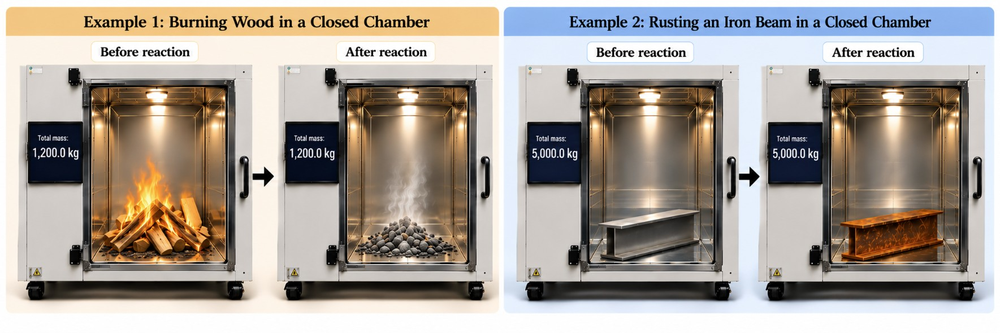{#fig-conservation-mass width="100%" fig-align="center" lightbox="true"}

::: callout-important
## Open Systems vs. Closed Systems

- In an **open system**, matter is not contained. Measuring only the remaining solid can make mass appear to have been lost or gained.
- In a **closed system**, matter is contained. The total mass remains the same, even if a chemical reaction occurs inside.

**Think like a chemist:** Before interpreting a change in mass, ask: *What exactly was weighed? Was the system open or closed?*
:::

::: callout-note
## From Conservation of Mass to Chemical Equations

Recall Dalton's atomic theory: **atoms are not created or destroyed during ordinary chemical reactions**. They are rearranged into a new combination.

**Our next question:** If atoms are conserved during chemical reactions, how do we represent that conservation when writing and **balancing chemical equations**?
:::

------------------------------------------------------------------------

### How Do We Know a Chemical Reaction Has Occurred?

We have established that a chemical reaction involves the rearrangement of atoms to form new substances.

But how do we know when a chemical reaction has occurred?

As scientists, we begin by making **observations**.

In many chemical reactions, we can observe changes in the physical properties of the substances involved.

#### Observable Evidence of a Chemical Reaction

Some common observations include:

- **Change in color:** A substance develops a different color.
- **Production of light:** Light is emitted during a reaction.
- **Formation of a solid:** A new solid forms, sometimes as a precipitate.
- **Formation of a gas:** Bubbles or gases are produced.
- **Absorption or release of heat:** The temperature of the surroundings changes.

::: callout-important
## Describing Chemical Reactions

Describing chemical reactions only in words is askward and time-consuming.

That is why, chemist use a chemical equation.

A **chemical equation** *is a symbolic representation of a chemical reaction.*
:::

### Classes of Chemical Reactions

Chemical reactions can involve different combinations of elements and compounds.

Although individual reactions may appear complicated, many can be organized into a few recognizable patterns.

#### Four Common Reaction Classes

| Reaction class | General pattern | What happens? |
|:---------------------|:--------------------------:|:---------------------|
| **Decomposition** | $AB \rightarrow A + B$ | One compound breaks down into simpler substances. |
| **Combination (Synthesis)** | $A + B \rightarrow AB$ | Two substances combine to form one compound. |
| **Single Displacement** | $A + BC \rightarrow AC + B$ | One element replaces another element in a compound. |
| **Double Displacement** | $AB + CD \rightarrow AD + CB$ | Two compounds exchange components to form two different compounds. |

: Four common classes of chemical reactions, adapted conceptually from Table 5.1 in the provided chemistry textbook. The letters represent hypothetical substances or components, not specific chemicals.

::: callout-note
## Reading the Patterns

In these simplified equations:

- **Letters** represent elements or components of compounds.
- The **plus sign (+)** separates substances.
- The **arrow (**$\rightarrow$) separates reactants from products and can be read as "produces" or "yields."

These patterns help us recognize how substances are rearranged during chemical reactions.

They do not tell us whether a reaction will occur under particular conditions.
:::

::: callout-important
## Connecting Reaction Classes to Dalton

Recall that Dalton proposed that atoms are rearranged during chemical reactions.

Notice that in each of the four reaction patterns, the same letters appear before and after the arrow.

**The arrangement changes, but the components are conserved.**

This is the conceptual foundation for writing and balancing chemical equations.
:::

### Writing Chemical Equations

We have used words to describe chemical reactions.

Chemists also use **chemical equations** to represent reactions using chemical symbols and formulas.

A chemical equation identifies the reactants and products and represents the transformation from one set of substances to another.

$$
\underbrace{A + B}_{\text{Reactants}}
\longrightarrow
\underbrace{AB}_{\text{Product}}
$$

#### Reading a Chemical Equation

When reading a chemical equation:

- **Reactants** are written on the left side of the arrow.
- **Products** are written on the right side of the arrow.
- A **plus sign (+)** separates multiple substances.
- An **arrow (**$\rightarrow$) indicates the direction in which the reaction is written.

The symbols and formulas allow chemists to communicate chemical reactions without writing a lengthy verbal description.

#### Chemical Formulas: Subscripts and Coefficients

Two numbers are especially important when interpreting chemical equations.

**Subscripts** indicate how many atoms of an element are represented in a chemical formula.

For example:

:::: {.content-visible when-format="html"}
::: {style="text-align: center; font-family: Georgia, serif; font-size: 2rem; margin: 1.5rem 0;"}
H<sub style="color: #2563eb; font-weight: bold;">2</sub>O
:::
::::

::: {.content-visible when-format="pdf"}
$$
H_2O
$$
:::

The subscript [**2**]{style="color: #2563eb;"} indicates that the formula contains two hydrogen atoms.

**Coefficients** indicate how many molecules or formula units of a substance are represented.

For example:

:::: {.content-visible when-format="html"}
::: {style="text-align: center; font-family: Georgia, serif; font-size: 2rem; margin: 1.5rem 0;"}
[2]{style="color: #ea580c; font-weight: bold;"}H<sub>2</sub>O
:::
::::

::: {.content-visible when-format="pdf"}
$$
2H_2O
$$
:::

The coefficient [**2**]{style="color: #ea580c;"} means there are two water molecules represented.

Together, those two molecules contain:

- 4 hydrogen atoms
- 2 oxygen atoms

::: callout-warning
## Coefficients vs. Subscripts

When balancing chemical equations, we change **coefficients**, not subscripts.

Changing a subscript changes the chemical formula and therefore the identity of the substance being represented.
:::

### Why Must Chemical Equations Be Balanced?

Recall the law of conservation of mass.

Atoms are not created or destroyed during ordinary chemical reactions.

Therefore, a chemical equation must show the **same number of atoms of each element on both sides of the arrow**.

A balanced equation represents the conservation of atoms during a chemical reaction.

::: callout-note
## What Is a Diatomic?

A **diatomic element** is a specific type of molecule made up of **two of the same atoms bonded together**.

Some elements naturally exist as diatomic molecules rather than as individual atoms.

There are **seven commonly recognized diatomic elements**:

| Chemical formula | Element  |
|:----------------:|:---------|
|        H₂        | Hydrogen |
|        N₂        | Nitrogen |
|        F₂        | Fluorine |
|        O₂        | Oxygen   |
|        I₂        | Iodine   |
|       Cl₂        | Chlorine |
|       Br₂        | Bromine  |

One way to remember these seven elements is the phrase:

**Have No Fear Of Ice Cold Beer**

Each word begins with the chemical symbol of a diatomic element.

Notice that each chemical formula contains the subscript **2**, indicating that the molecule contains two atoms of that element.

In our next example, we will use two of these diatomic elements, **hydrogen (H₂)** and **oxygen (O₂)**, to practice balancing a chemical equation.
:::

#### A Simple Example

Consider the following equation:

$$
H_2 + O_2 \rightarrow H_2O
$$

Let's count the atoms on each side.

| Element      | Reactants | Products |
|:-------------|----------:|---------:|
| Hydrogen (H) |         2 |        2 |
| Oxygen (O)   |         2 |        1 |

The hydrogen atoms are balanced, but the oxygen atoms are not.

We can begin balancing the equation by changing the coefficient in front of water:

$$
H_2 + O_2 \rightarrow 2H_2O
$$

Now count again.

| Element      | Reactants | Products |
|:-------------|----------:|---------:|
| Hydrogen (H) |         2 |        4 |
| Oxygen (O)   |         2 |        2 |

Oxygen is now balanced, but hydrogen is not.

We can balance the hydrogen atoms by changing the coefficient in front of hydrogen:

$$
\boxed{2H_2 + O_2 \rightarrow 2H_2O}
$$

Our final count is:

| Element      | Reactants | Products |
|:-------------|----------:|---------:|
| Hydrogen (H) |         4 |        4 |
| Oxygen (O)   |         2 |        2 |

The equation is now balanced.

::: callout-tip
## A Simple Approach to Balancing Equations

1.  Identify the reactants and products.
2.  Count the atoms of each element on both sides.
3.  Adjust the coefficients to balance the atom counts.
4.  Never change the subscripts.
5.  Count the atoms again to verify that the equation is balanced.

**Remember:** Balancing equations is not about changing the substances. It is about accounting for the atoms already present.
:::

### Bringing the Concepts Together

We have developed three important ways to think about chemical reactions.

| Question | Chemistry concept |
|:-----------------------------------|:-----------------------------------|
| How do we know something may be reacting? | Observe changes and evaluate evidence. |
| What kind of reaction might be occurring? | Recognize patterns of chemical reactions. |
| How do we represent the reaction? | Write and balance chemical equations. |

::: callout-note
## Connecting Chemistry to Hazardous Materials Management

In hazardous materials management, recognizing **element names, chemical symbols, and how substances interact** is essential for communicating and interpreting information about hazardous materials.

Think about it: Will every Safety Data Sheet (SDS), chemical label, or technical document spell out every element's name or explain how substances interact?

**Not necessarily.**

Professionals working with hazardous materials are expected to have a basic understanding of chemistry so they can recognize chemical information, interpret potential hazards, and make informed decisions.

**Think like a chemist:** You do not need to become a chemist, but you do need to understand enough chemistry to recognize hazards and ask the right questions.
:::

------------------------------------------------------------------------

### Introducing Oxidation Numbers

We have learned how to write and balance chemical equations by accounting for the atoms on each side of a reaction.

However, balancing an equation does not tell us everything about what happens during a chemical reaction.

To understand **oxidation and reduction (REDOX)**, we need to introduce another concept: **oxidation numbers**.

An **oxidation number** is a number assigned to an atom using a set of rules that helps us track changes in electrons during a chemical reaction.

When we analyze oxidation and reduction, we will show oxidation numbers **above the element symbols**. Coefficients and subscripts retain their usual meanings.

#### Rules for Assigning Oxidation Numbers

| Rule                             | Oxidation number | Example  |
|:---------------------------------|:----------------:|:---------|
| An element in its elemental form |        0         | H₂ or O₂ |
| Group 1 metals                   |        +1        | LiH      |
| Group 2 metals                   |        +2        | CaO      |
| Hydrogen                         |    Usually +1    | H₂O      |
| Oxygen                           |    Usually −2    | H₂O      |
| Group 17 halogens                |    Usually −1    | NaCl     |

These are useful starting rules. Some elements have exceptions depending on the substances with which they are combined.

#### Important Exceptions

**Hydrogen**

Hydrogen usually has an oxidation number of **+1** in compounds.

However, when hydrogen forms a metal hydride, its oxidation number is **−1**.

For example, in lithium hydride:

$$
\overset{+1}{Li}\overset{-1}{H}
$$

- Lithium (Li): +1
- Hydrogen (H): −1

**Oxygen**

Oxygen usually has an oxidation number of **−2** in compounds.

However, in a peroxide, such as:

$$
\overset{+1}{H}_2\overset{-1}{O}_2
$$

Each oxygen atom has an oxidation number of **−1**.

::: callout-important
## Oxidation Numbers Must Add Up

The sum of the oxidation numbers must equal the overall charge of the chemical species.

- In a **neutral compound**, the sum equals **0**.
- In a **polyatomic ion**, the sum equals the **charge of the ion**.

We can use this rule to determine an oxidation number that we do not already know.
:::

#### Worked Example: The Carbonate Ion

Consider the carbonate ion:

$$
CO_3^{2-}
$$

We want to determine the oxidation number of **carbon (C)**.

**Step 1: Identify what we already know.**

Oxygen normally has an oxidation number of −2.

There are three oxygen atoms in the carbonate ion.

Therefore:

$$
3(-2)=-6
$$

**Step 2: Account for the overall charge.**

The carbonate ion has an overall charge of −2.

Let $x$ represent the oxidation number of carbon.

$$
x+3(-2)=-2
$$

**Step 3: Solve for carbon.**

$$
x-6=-2
$$

$$
\boxed{x=+4}
$$

Therefore, in the carbonate ion:

- Carbon has an oxidation number of **+4**.
- Each oxygen has an oxidation number of **−2**.
- The sum of the oxidation numbers equals **−2**, matching the charge of the ion.

::: callout-tip
## Think Like a Chemist

We did not need to memorize the oxidation number of carbon in carbonate.

Instead, we used the oxidation numbers we already knew and the overall charge of the ion to **deduce the unknown value**.
:::

### Periodic Table: Oxidation Number Reference

The periodic table helps us recognize patterns in oxidation numbers across groups of elements.

The following reference brings together the common oxidation numbers, selected exceptions, and the method we used to solve for carbon in the carbonate ion.

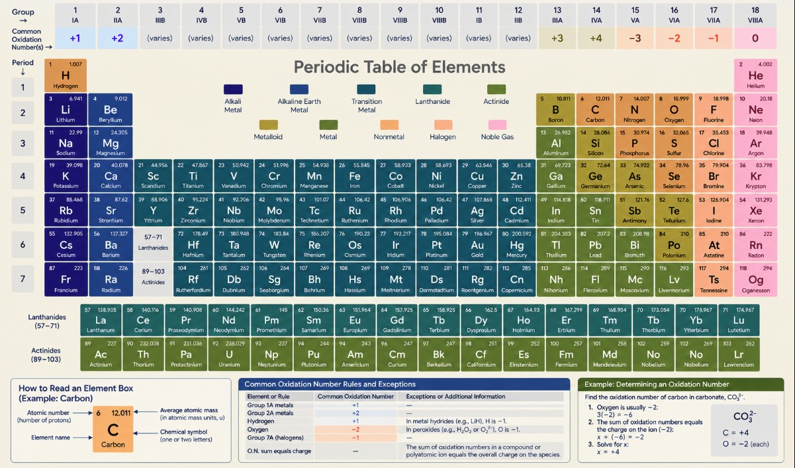{#fig-periodic-oxidation width="100%" fig-align="center" lightbox="true"}

### Understanding REDOX Reactions

#### The Original Definition of Oxidation

Historically, **oxidation** was described as the addition of oxygen to a substance.

Consider two examples:

**Example 1: Magnesium Reacting with Oxygen**

$$
2Mg + O_2 \rightarrow 2MgO
$$

Oxygen combines with magnesium to form magnesium oxide.

We say that **magnesium is being oxidized**, or that magnesium is undergoing oxidation.

**Example 2: Iron Reacting with Oxygen**

$$
4Fe + 3O_2 \rightarrow 2Fe_2O_3
$$

Oxygen combines with iron to form iron(III) oxide.

We say that **iron is being oxidized**, or that iron is undergoing oxidation.

This reaction illustrates the oxidation of iron associated with rust formation. Actual rusting also involves water.

Both examples reflect the original definition of oxidation: **adding oxygen**.

### Let's Practice: Balancing the Magnesium Reaction

We have learned how to assign oxidation numbers and how to balance chemical equations by counting atoms. Let's use both skills together.

#### Step 1: Start with the Chemical Equation

Magnesium reacts with diatomic oxygen to form magnesium oxide.

$$
Mg + O_2 \rightarrow MgO
$$

#### Step 2: Assign Oxidation Numbers

Before changing any coefficients, identify the oxidation numbers of the elements.

- Magnesium (Mg) and oxygen (O₂) are in their **elemental forms**, so each has an oxidation number of **0** on the reactant side.
- In magnesium oxide (MgO), magnesium has an oxidation number of **+2** and oxygen has an oxidation number of **−2**.

$$
\overset{0}{Mg} + \overset{0}{O}_2 \rightarrow \overset{+2}{Mg}\overset{-2}{O}
$$

**Check the oxidation numbers in MgO:**

$$
(+2)+(-2)=0
$$

The oxidation numbers add to zero because magnesium oxide is a neutral compound.

#### Step 3: Count the Atoms

| Element   | Reactants | Products |
|:----------|----------:|---------:|
| Magnesium |         1 |        1 |
| Oxygen    |         2 |        1 |

Magnesium is balanced, but oxygen is not.

#### Step 4: Balance Oxygen

Place a coefficient of 2 in front of MgO.

$$
\overset{0}{Mg} + \overset{0}{O}_2 \rightarrow 2\overset{+2}{Mg}\overset{-2}{O}
$$

Count the atoms again.

| Element   | Reactants | Products |
|:----------|----------:|---------:|
| Magnesium |         1 |        2 |
| Oxygen    |         2 |        2 |

Oxygen is now balanced, but magnesium is not.

#### Step 5: Balance Magnesium

Place a coefficient of 2 in front of Mg.

$$
\boxed{2\overset{0}{Mg} + \overset{0}{O}_2 \rightarrow 2\overset{+2}{Mg}\overset{-2}{O}}
$$

#### Step 6: Verify the Atoms and Oxidation Numbers

**First, count the atoms.**

| Element   | Reactants | Products |
|:----------|----------:|---------:|
| Magnesium |         2 |        2 |
| Oxygen    |         2 |        2 |

The number of atoms is equal on both sides.

**Next, check the oxidation numbers.**

| Element   | Reactants | Products |
|:----------|----------:|---------:|
| Magnesium |         0 |       +2 |
| Oxygen    |         0 |       −2 |

In each MgO unit, the oxidation numbers add to zero: $(+2)+(-2)=0$.

The coefficients have balanced the atoms, but **they do not change the oxidation numbers**. The changes from 0 to +2 and from 0 to −2 are what we will examine next.

**What do these changes tell us about the electrons?**

### The Modern Definition: What Happens to Electrons?

Scientists later recognized that oxidation involves changes in electrons, not simply the addition of oxygen.

Let's return to our balanced magnesium reaction.

$$
2\overset{0}{Mg} + \overset{0}{O}_2 \rightarrow 2\overset{+2}{Mg}\overset{-2}{O}
$$

#### Assigning Oxidation Numbers

Recall our rules:

- Elements in their elemental form have an oxidation number of **0**.
- Magnesium is a Group 2 metal and has an oxidation number of **+2** in MgO.
- Oxygen normally has an oxidation number of **−2** in compounds.

We can show the oxidation numbers directly above each element in the chemical equation.

$$
2\overset{0}{Mg}
+
\overset{0}{O}_2
\rightarrow
2\overset{+2}{Mg}\overset{-2}{O}
$$

| Element        | Reactants | Products |
|:---------------|----------:|---------:|
| Magnesium (Mg) |         0 |       +2 |
| Oxygen (O)     |         0 |       −2 |

**What do you notice?**

Magnesium changes from 0 to +2.

Oxygen changes from 0 to −2.

#### Identifying Oxidation and Reduction

**Magnesium:**

Magnesium loses two electrons.

$$
\overset{0}{Mg} \rightarrow Mg^{2+} + 2e^-
$$

Its oxidation number increases from 0 to +2.

Therefore, **magnesium is oxidized**.

**Oxygen:**

Oxygen gains two electrons.

Its oxidation number decreases from 0 to −2.

Therefore, **oxygen is reduced**.

This gives us the modern definitions:

- **Oxidation:** Loss of electrons.
- **Reduction:** Gain of electrons.

#### How Can We Remember Oxidation and Reduction?

Two common memory aids are:

**OIL RIG**

- **OIL:** Oxidation Is Loss
- **RIG:** Reduction Is Gain

**LEO goes GER**

- **LEO:** Loss of Electrons is Oxidation
- **GER:** Gain of Electrons is Reduction

::: callout-tip
## Think About the Charge

Another way to remember oxidation and reduction is to think about electrons and their negative charge.

**When an atom gains electrons:**

- It gains negative charge.
- Its charge becomes more negative.
- It undergoes **reduction**.

**When an atom loses electrons:**

- It loses negative charge.
- Its charge becomes more positive.
- It undergoes **oxidation**.

Remember: Electrons carry a negative charge.
:::

### Returning to Iron: Oxidation and Rusting

Now let's apply the same reasoning to the iron reaction we introduced earlier.

$$
4\overset{0}{Fe}
+
3\overset{0}{O}_2
\rightarrow
2\overset{+3}{Fe}_2\overset{-2}{O}_3
$$

| Element | Reactants | Products | What happened? |
|:--------|----------:|---------:|:---------------|
| Iron    |         0 |       +3 | Oxidation      |
| Oxygen  |         0 |       −2 | Reduction      |

Each iron atom loses 3 electrons.

Each oxygen atom gains 2 electrons.

**Verify the electrons:**

Four iron atoms each lose 3 electrons:

$$
4(3)=12\text{ electrons lost}
$$

Six oxygen atoms each gain 2 electrons:

$$
6(2)=12\text{ electrons gained}
$$

Therefore:

$$
\boxed{12\text{ electrons lost}=12\text{ electrons gained}}
$$

**Iron is oxidized, and oxygen is reduced.**

### What Is a REDOX Reaction?

A **REDOX reaction** is a chemical reaction in which oxidation and reduction both occur.

The name combines:

- **RED:** Reduction
- **OX:** Oxidation

When one substance loses electrons, another substance gains electrons.

**Does a REDOX reaction need to involve oxygen?**

**No.**

Although oxidation was originally associated with oxygen, REDOX reactions do not require oxygen.

A reaction is classified as REDOX when oxidation and reduction occur.

### Identifying Oxidation and Reduction: Additional Examples

The following examples are adapted from the Khan Academy video *Simple Redox Reactions*.

#### Example 1: Sodium and Chlorine

$$
2\overset{0}{Na}
+
\overset{0}{Cl}_2
\rightarrow
2\overset{+1}{Na}\overset{-1}{Cl}
$$

| Element  | Before | After | What happened? |
|:---------|-------:|------:|:---------------|
| Sodium   |      0 |    +1 | Oxidation      |
| Chlorine |      0 |    −1 | Reduction      |

**Sodium is oxidized. Chlorine is reduced.**

#### Example 2: A Reaction That Is Not REDOX

$$
\overset{+1}{Na}\overset{-1}{Cl}
+
\overset{+1}{Ag}\overset{-1}{F}
\rightarrow
\overset{+1}{Na}\overset{-1}{F}
+
\overset{+1}{Ag}\overset{-1}{Cl}
$$

| Element  | Before | After |
|:---------|-------:|------:|
| Sodium   |     +1 |    +1 |
| Chlorine |     −1 |    −1 |
| Silver   |     +1 |    +1 |
| Fluorine |     −1 |    −1 |

None of the oxidation numbers change.

Therefore, **this is not a REDOX reaction**.

::: callout-important
## Not Every Chemical Reaction Is REDOX

A chemical reaction can occur without oxidation or reduction.

To identify a REDOX reaction, compare the oxidation numbers of the elements before and after the reaction.

- An **increase** in oxidation number indicates oxidation.
- A **decrease** in oxidation number indicates reduction.
- If no oxidation numbers change, the reaction is not REDOX.
:::

#### Application: Preventing Rust with Zinc


{#fig-rust-beams width="100%" fig-align="center" lightbox="true"}

<small>**Image source:** [Binic Abrasive, *Professional Way to Remove Rust from Steel Beams*](https://binictools.com/professional-way-to-remove-rust-from-steel-beams/). Original photographer and image location unverified.</small>


We have learned that iron undergoes oxidation when it reacts with oxygen, which can lead to rusting.

This is a simplified explanation. In reality, rusting involves more complex chemical reactions that can be better understood through electrochemistry.

However, we can still apply our understanding of oxidation and reduction to prevent iron from rusting.

One common method is to coat iron or steel with **zinc**, a process called **galvanization**.

##### How Does Zinc Protect Iron?

Consider an iron nail coated with zinc.

Zinc provides two forms of protection.

**1. Zinc Acts as a Protective Barrier**

The zinc coating creates a barrier between the iron and its surrounding environment.

This prevents oxygen and moisture (H₂O) from reaching the iron, helping prevent rusting.

But what happens if the zinc coating becomes scratched and some of the iron is exposed?

**2. Zinc Oxidizes Before Iron**

Zinc is more reactive than iron.

This means zinc more readily loses electrons and undergoes oxidation.

When zinc loses electrons:

$$
\overset{0}{Zn}
\rightarrow
Zn^{2+}+2e^-
$$

Zinc's oxidation number increases from **0 to +2**.

Iron can also undergo oxidation:

$$
\overset{0}{Fe}
\rightarrow
Fe^{2+}+2e^-
$$

However, zinc is more readily oxidized than iron.

Even when the zinc coating is scratched, the surrounding zinc can continue protecting the exposed iron by undergoing oxidation instead.

This is called **sacrificial protection** because zinc is gradually consumed while helping protect the iron from rusting.

::: callout-important
## Connecting Chemistry to Hazardous Materials Management

Why does this matter for hazardous materials management?

Iron and steel are commonly used in equipment such as:

- Storage tanks
- Pipelines
- Structural supports
- Containers used to store hazardous materials

Rusting can weaken these materials and increase the risk of equipment failure.

By understanding oxidation and reduction, we can explain why zinc coatings help protect iron and steel.
:::

### Application 2: Oxidizers in Hazardous Materials Management

We have spent time learning how chemical reactions work, how to balance chemical equations, and how to identify oxidation and reduction.

We then applied this knowledge to understand how zinc can help prevent iron from rusting.

But what happens when we encounter chemicals that can cause other materials to burn more intensely?

This brings us back to **hazardous materials management**.

#### What Is an Oxidizer?

In ordinary combustion, oxygen from the surrounding air commonly acts as an **oxidizing agent**.

An **oxidizing agent** is a substance that causes another substance to undergo oxidation while the oxidizing agent itself undergoes reduction.

However, **oxygen gas is not the only substance capable of acting as an oxidizer**.

Some solid chemicals can also cause or intensify combustion.

Examples include:

- **Potassium permanganate (KMnO₄)**
- **Ammonium nitrate (NH₄NO₃)**
- **Potassium chlorate (KClO₃)**

These substances have different chemical properties and hazards, but each can act as an oxidizer under appropriate conditions.

::: callout-important
## Connecting REDOX Chemistry to Hazardous Materials

Recall what we learned about oxidation and reduction:

- **Oxidation:** Loss of electrons.
- **Reduction:** Gain of electrons.
- **Oxidizing agent:** Causes another substance to undergo oxidation.

An oxidizer does not necessarily need to burn itself to make another material burn more intensely.

This is why understanding REDOX reactions helps us recognize the hazards associated with oxidizing materials.
:::

### Example: Ammonium Nitrate

**Ammonium nitrate (NH₄NO₃)** is a white crystalline solid commonly used in agricultural fertilizers and certain industrial applications.

It is classified as an **oxidizing solid** because it can support or intensify combustion involving other materials.

Unlike an ordinary combustible material, ammonium nitrate does not need to act as the fuel to contribute to a dangerous fire.

The following video illustrates the hazards associated with ammonium nitrate.

As you watch, consider how the chemistry we have learned helps explain why an oxidizing material can contribute to a dangerous incident.



### OSHA Regulations: Storage of Ammonium Nitrate

Now that we understand why ammonium nitrate can be hazardous, let's consider how this knowledge is applied to workplace safety.

OSHA establishes requirements for the storage of ammonium nitrate under **29 CFR 1910.109(i)**.

Some important requirements include:

- **Temperature:** Ammonium nitrate must not be accepted for storage when its temperature exceeds **130°F (54°C)**.
- **Storage clearance:** Applicable storage arrangements must maintain at least **36 inches of clearance** below the roof or supporting structural members.
- **Ventilation:** Storage buildings must have adequate ventilation or provisions for ventilation during a fire.
- **Chemical compatibility:** Ammonium nitrate must be separated from specified combustible materials and incompatible substances.
- **Contamination prevention:** Storage areas must be maintained to prevent contamination with materials that could increase fire or explosion hazards.
- **Storage management:** Piles and bins must be arranged to meet applicable requirements for access, spacing, and material handling.

These requirements illustrate how **chemical properties influence workplace safety regulations**.

**Regulatory reference:** [OSHA 29 CFR 1910.109(i): Storage of Ammonium Nitrate](https://www.osha.gov/laws-regs/regulations/standardnumber/1910/1910.109)

### Unstable Materials

Some solids may also undergo hazardous reactions when exposed to **heat, friction, shock, moisture, or incompatible substances**.

These hazards are substance-specific.

Not every oxidizer is shock-sensitive, and not every unstable material is an oxidizer.

Understanding the chemical properties of a material helps us recognize the conditions under which it may become hazardous.

**Key takeaway:** Understanding oxidation and reduction helps us explain why some materials burn, why others intensify combustion, and why chemical compatibility is essential for hazardous materials management.

# 4. Temperature, Physical Change, and Chemical Change

Recall Lecture 02:

- A **physical change** changes a material's form or state without changing its chemical identity.
- A **chemical change** produces one or more different substances.

## Heating a solid

When temperature changes, several different processes may become relevant:

| Process | Type | Hazard management question |
|------------------------|------------------------|------------------------|
| Thermal expansion | Physical | Could expansion damage equipment, seals, or packaging? |
| Melting | Physical | Could a previously contained solid begin to flow or spread? |
| Sublimation (for some solids) | Physical | Could a solid produce vapor without first becoming a liquid? |
| Thermal decomposition | Chemical | Could heating produce hazardous gases or other substances? |
| Combustion (for combustible solids) | Chemical | Could heat and ignition produce fire and harmful combustion products? |

**Melting point** is a physical property, but it does not by itself tell us whether a material will burn, decompose, or release hazardous vapors.

# Key Takeaways

1.  **A solid is a state of matter, not a hazard classification.** A material's chemical identity, physical form, and environmental conditions determine its potential hazards.

2.  **Particle size influences exposure.** Cutting, grinding, burning, and other processes can generate airborne particles. Particle size and chemical composition influence how particles move through the air, where they deposit in the respiratory system, and their potential health effects.

3.  **Airborne particles can affect the respiratory and cardiovascular systems.** Certain particulate exposures may contribute to cellular injury, oxidative stress, inflammation, and other adverse health effects. Biomonitoring can help investigate internal exposure, but results must be interpreted alongside sampling time, detection limits, and biological processes.

4.  **Combustible dust can create fire and explosion hazards.** The dust explosion pentagon identifies five important conditions: combustible dust, oxygen, an ignition source, dispersion, and confinement.

5.  **Chemical compatibility is essential when managing reactive solids.** Potassium metal demonstrates how contact with water can produce heat, corrosive potassium hydroxide, and flammable hydrogen gas.

6.  **Chemical equations help us understand chemical reactions.** Reactants are converted into products as atoms are rearranged. The law of conservation of mass explains why chemical equations must be balanced. We balance equations by changing coefficients, not subscripts.

7.  **Oxidation numbers help us identify REDOX reactions.** Oxidation numbers allow us to track changes during chemical reactions. An increase in oxidation number indicates oxidation, while a decrease indicates reduction. Not every chemical reaction is a REDOX reaction.

8.  **Oxidation and reduction involve changes in electrons.** Oxidation involves the loss of electrons, while reduction involves the gain of electrons. These processes occur together in REDOX reactions. Zinc demonstrates how this chemistry can be applied to protect iron and steel from rusting through galvanization and sacrificial protection.

9.  **Oxidizers can intensify combustion without acting as conventional fuels.** Ammonium nitrate demonstrates why understanding oxidizing properties, chemical incompatibility, temperature, contamination prevention, and applicable OSHA storage requirements is important for hazardous materials management.

10. **Hazardous materials management requires understanding how materials behave.** Temperature can cause physical changes, such as melting and sublimation, or chemical changes, such as decomposition and combustion. Identifying chemical properties, evaluating exposure conditions, and reviewing safety information and regulations help us make informed decisions.

::: callout-important
## Think Like a Chemist

Throughout this lecture, we have practiced using observations, chemical principles, and evidence to understand how materials behave.

**Observe → Explain → Predict → Decide**

We do not need to become chemists to manage hazardous materials.

However, understanding chemistry helps us recognize potential hazards, explain why they occur, and make informed decisions about how to prevent harmful outcomes.
:::

# Key Terms

| Term | Working definition |
|:-----------------------------------|:-----------------------------------|
| **Solid** | State of matter that ordinarily maintains its shape and volume under specified conditions. |
| **Particle size** | Characteristic dimension of a particle that influences its movement, suspension, and potential deposition in the respiratory system. |
| **Particulate matter (PM)** | Solid particles and liquid droplets suspended in air. |
| **PM10** | Particles with aerodynamic diameters of 10 micrometers (µm) or smaller. |
| **PM2.5** | Fine particles with aerodynamic diameters of 2.5 µm or smaller. |
| **PM1** | Particles with aerodynamic diameters of 1 µm or smaller. |
| **Aerosol** | Suspension of solid particles or liquid droplets in a gas. |
| **Macrophage** | Immune cell that helps recognize and remove foreign material, including inhaled particles. |
| **Oxidative stress** | Cellular condition in which excessive reactive oxygen species contribute to damage to biological structures. |
| **Biomonitoring** | Measurement of chemicals, metabolites, or exposure-related markers in biological samples such as blood or urine. |
| **Limit of Detection (LOD)** | Smallest amount of a substance that an analytical method can reliably distinguish from background. |
| **Limit of Quantification (LOQ)** | Smallest amount of a substance that an analytical method can reliably measure quantitatively. |
| **Combustible dust** | Finely divided combustible solid material that can create fire or explosion hazards when dispersed in air under appropriate conditions. |
| **Dust explosion pentagon** | Five conditions associated with combustible dust explosions: fuel, oxygen, ignition source, dispersion, and confinement. |
| **Reactive solid** | Solid material capable of undergoing hazardous chemical reactions under certain conditions, including contact with incompatible substances. |
| **Chemical incompatibility** | Potential for hazardous reactions when certain substances come into contact. |
| **Chemical reaction** | Process in which one or more substances are converted into different substances through the rearrangement of atoms. |
| **Reactant** | Starting substance in a chemical reaction. |
| **Product** | Substance formed during a chemical reaction. |
| **Law of conservation of mass** | Principle that the total mass of a closed system remains constant during an ordinary chemical reaction. |
| **Chemical equation** | Symbolic representation of a chemical reaction using chemical formulas and symbols. |
| **Coefficient** | Number placed before a chemical formula to indicate the relative number of molecules or formula units. |
| **Subscript** | Number in a chemical formula indicating the number of atoms of an element represented. |
| **Diatomic molecule** | Molecule consisting of two atoms. |
| **Oxidation number** | Number assigned to an atom using a set of rules to help track changes in electrons during chemical reactions. |
| **Oxidation** | Chemical process involving the loss of electrons and an increase in oxidation number. |
| **Reduction** | Chemical process involving the gain of electrons and a decrease in oxidation number. |
| **REDOX reaction** | Chemical reaction in which oxidation and reduction both occur. |
| **Oxidizing agent (oxidant)** | Substance that causes another substance to undergo oxidation while itself undergoing reduction. |
| **Reducing agent (reductant)** | Substance that causes another substance to undergo reduction while itself undergoing oxidation. |
| **Galvanization** | Process of applying a protective zinc coating to iron or steel to help prevent rusting. |
| **Sacrificial protection** | Protection of a metal by another metal that more readily undergoes oxidation. |
| **Oxidizer** | Substance capable of causing or intensifying the combustion of another material, generally by providing an oxidizing environment. |
| **Combustion** | Rapid, heat-releasing chemical reaction that commonly involves a fuel reacting with an oxidizer. |
| **Thermal decomposition** | Chemical breakdown of a substance caused by heating. |
| **Melting** | Physical transition from a solid to a liquid. |
| **Sublimation** | Physical transition directly from a solid to a gas. |
| **Physical change** | Change in a material's form or state without changing its chemical identity. |
| **Chemical change** | Change that produces one or more different substances. |

# Copyright & Use

**SHM 377: Hazardous Materials Management**\
© 2026 Yoni Rodriguez

Except where otherwise noted, original course materials are licensed under the Creative Commons Attribution-NonCommercial 4.0 International License (CC BY-NC 4.0).

Third-party materials remain subject to their respective copyright and licensing terms.
